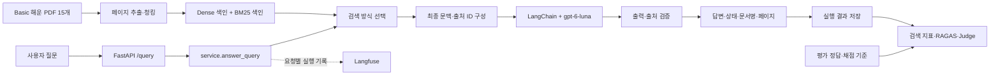

# Basic 해운 RAG Q&A 서비스 설계안

작성일: 2026-11-05 · 수정일: 2026-11-06. A의 데이터 처리·Naive 검색, B의 답변 생성·API, C의 실행 기록·평가 코드가 각 패키지에 들어왔다. Hybrid·리랭킹, 세 방식 비교 평가와 보안 비교 결과는 아직 없다.

관련 문서: [문서 목차](../README.md) · [공통 입출력·호출 계약](contracts.md) · [Git 저장소·협업 설계](../guides/git-workflow.md)

## 1. 목표와 확정 범위

물류 담당자가 제공된 Basic 해운 PDF를 근거로 예약, 서류 제출, 처리 상태와 비용 관련 질문에 답을 얻는 서비스다. 답변에는 문서명과 PDF 페이지를 표시하고, 필요한 조건이 빠지면 되묻고, 자료가 부족하거나 문서 차이를 해결하지 못하면 이유를 설명하고 보류한다.

사용자 결정: **우선 Basic부터 구현한다.** 이후 Intermediate·Advanced로 확장할 수 있도록 데이터 경로와 색인, 설정을 분리한다.

| 구분 | 설계 기준 |
| --- | --- |
| 고정 자료 | 발제문에 제공된 Basic 해운 ZIP 2개. PDF 15개, 각 24쪽, 총 360쪽 |
| 업무 범위 | 부산→LA 일반 건화물의 예약, 서류 제출, 적용 조건과 처리 상태 |
| 비용 질의 | PDF에서 확인 가능한 설명을 답한다. 요율·계약 조건 등이 없으면 금액 계산을 보류한다 |
| 주요 판단 | 접수와 확정, 요청과 실제 완료, 예정과 실제 완료를 구분한다 |
| 필수 기술 | FastAPI, Pydantic, LangChain, Langfuse, 생성 모델 `gpt-6-luna` |
| 필수 비교 | Naive RAG / Hybrid RAG / Hybrid + Reranking |
| 시연 | FastAPI `/docs`에서 질문·검색 방식 선택과 응답 확인 |

Basic 안내는 복합 운임 계산을 요구하지 않는다. 안내에 나온 `S-DEV-30`도 요율과 계약 조건이 없어 계산할 수 없다고 답하는 문항이다. 따라서 Basic에는 범용 비용 계산기를 넣지 않는다. 비용 질문을 일괄 거절하지 않고, 확인 가능한 내용과 계산할 수 없는 부분을 구분한다.

실제 예약 접수, 선사 API 연동, 외부 자료 수집, 프런트엔드, 대화 메모리, 자동 문서 갱신은 현재 구현 범위에 포함하지 않는다. 사용자는 추가 조건을 포함한 완성된 질문을 다시 제출할 수 있다.

이 설계는 발제문과 Basic 데이터셋 안내를 확인해 작성했다. ZIP 내부 PDF와 실제 평가 문항 전체는 아직 열어보지 않았으므로 문서별 내용, 최적 청킹 설정, 최종 평가 질문 목록과 성능은 구현 단계에서 확인한다.

## 2. 구조의 핵심

**사람별 최상위 패키지 안에서 기능을 모듈화하고, 메인 파일은 초기화·연결 함수를 호출한다.** 질문 한 건의 실행 순서는 별도 서비스 함수에 둔다.

- `main.py`: FastAPI 앱 생성 함수 호출.
- `member_chsopo89/api/app.py`: 설정과 수명주기, 라우터, 오류 처리, 요청 추적 연결.
- `member_chsopo89/service/query.py`: 검색 → 문맥 구성 → 생성 → 출처 검증 순서 연결.
- 각 기능 모듈: 자기 기능과 공통 입출력 계약만 책임진다.

Basic의 import 경로는 담당자 ID를 붙인 `member_ysl727727`(A), `member_chsopo89`(B), `member_Damsebi`(C)와 `shared`로 고정한다(2026-11-06 팀 결정). 대소문자까지 그대로 사용한다. 패키지명을 다시 바꾸려면 폴더·import·설정·실행 명령을 팀 전체가 같은 변경에서 맞춘다. 사람별 패키지는 최종 코드 위치이며, 통합 시 하나의 `app/`으로 다시 옮기지 않는다. 각 패키지 안의 기능·scripts·prompts·tests는 해당 담당자가 관리한다.

예약·서류·비용은 사용자 업무 범주다. Basic에서는 세 범주를 별도 RAG 서비스나 검색 인덱스로 나누지 않는다. 하나의 질문이 예약 안내, 서류 조건과 정정 공지를 함께 필요로 할 수 있기 때문이다. 업무 범주는 프롬프트와 평가 사례에서 관리한다.



색인 생성은 사전 작업이고 API 요청 처리와 분리한다. 서버가 시작할 때 준비된 색인과 모델을 한 번 로드하며, 요청마다 PDF를 읽거나 임베딩을 다시 만들지 않는다.

## 3. 폴더 구조

아래는 **구현할 목표 구조**다. 현재는 루트 README와 `docs/` 문서만 정리되어 있으며 소스·데이터·평가 결과는 아직 생성하지 않았다. Python 패키지에는 `__init__.py`를 둔다. Git 추적 범위와 브랜치 규칙은 [Git 저장소·협업 설계](../guides/git-workflow.md)를 따른다.

```text
ADEN/
├── README.md
├── main.py                         # B: 앱 생성 함수만 호출
├── pyproject.toml                  # B: 의존성 변경 취합
├── uv.lock                         # uv 채택 시 추적하는 잠금 파일
├── .env.example                    # 실제 키를 제외한 변수 안내
├── .gitignore
├── .github/                        # PR 템플릿·CI, 구현 단계에 추가
├── shared/                         # 공통 계약·설정, B가 변경 취합
│   ├── __init__.py
│   ├── contracts.py                # 청크·응답·실행 기록 타입
│   ├── settings.py
│   └── exceptions.py
├── member_ysl727727/               # A의 최종 Python 패키지
│   ├── __init__.py
│   ├── ingestion/                  # PDF 추출·청킹
│   ├── indexing/                   # 임베딩·Dense/BM25 색인
│   ├── retrieval/                  # 세 검색 방식, service.py에 retrieve()
│   ├── scripts/
│   │   └── build_index.py
│   └── tests/
├── member_chsopo89/                # B의 최종 Python 패키지
│   ├── __init__.py
│   ├── api/                        # app.py에 create_app()
│   ├── generation/                 # context.py, chain.py, citations.py
│   ├── service/
│   │   ├── query.py                # A·B·C 함수 연결
│   │   └── resources.py            # 준비된 색인·모델 로드/종료
│   ├── prompts/
│   │   └── shipping_qa.txt
│   └── tests/
├── member_Damsebi/                 # C의 최종 Python 패키지
│   ├── __init__.py
│   ├── observability/
│   │   └── tracing.py              # Langfuse·시간·토큰·오류 기록
│   ├── evaluation/
│   │   ├── dataset.py
│   │   ├── runner.py
│   │   ├── metrics.py
│   │   ├── graders.py
│   │   ├── security.py
│   │   └── report.py
│   ├── prompts/
│   │   ├── judge.txt
│   │   └── defense.txt
│   ├── scripts/
│   │   ├── run_benchmark.py
│   │   └── run_security.py
│   └── tests/
├── configs/
│   └── basic.yaml                  # B가 공통 설정 취합
├── docs/
│   ├── README.md
│   ├── design/architecture.md
│   ├── design/contracts.md          # 공통 데이터·함수·실행 계약
│   ├── guides/git-workflow.md
│   └── plans/basic-day-plan-2026-11-05.md
├── data/
│   ├── README.md                   # A: 데이터 배치·처리 안내
│   └── basic/
│       ├── documents/              # 제공 PDF 원본, Git 제외
│       └── evaluation/             # 제공 질문·정답 JSON, Git 제외
├── presentations/                  # 발표자료 작성 시 추가
├── artifacts/                      # 추출·청크·색인·실행 기록, Git 제외
│   ├── basic/
│   └── experiments/<experiment_id>/
└── reports/<experiment_id>/         # C: 제출용 결과, Git 추적
    ├── README.md
    ├── manifest.json
    ├── comparison.csv
    ├── answers.jsonl
    ├── scores.jsonl
    └── security_comparison.csv
```

`member_Damsebi/evaluation/`은 코드, `data/basic/evaluation/`은 제공 데이터다. 서비스 런타임은 평가 코드와 정답 파일을 읽지 않는다. 데이터 처리기는 `data/basic/documents/*.pdf`만 허용하고 데이터 루트 전체를 재귀 색인하지 않는다.

원본 데이터와 `artifacts/`는 Git에서 제외하고, 제출할 비교표·답변·채점 결과·재현 설정은 검토 후 `reports/<experiment_id>/`에 보존한다. 선택한 일반 질문의 실패 결과도 함께 남긴다. 설계 설명은 `docs/`, 실행 결과는 `reports/`, 빠른 시작 안내는 루트 README에 둔다.

B의 `member_chsopo89/service/query.py`가 A의 검색 함수, B의 생성 함수, C의 추적 함수를 호출한다. 세 패키지는 `shared/contracts.py`를 공통 참조한다. `shared/`는 사람별 패키지를 import하지 않는다. A의 검색과 C의 추적 모듈도 B의 서비스·API를 역으로 import하지 않는다. C의 평가 실행기는 호출 함수나 API 클라이언트를 주입받아 순환 참조 없이 동작한다. 색인·모델 초기화 연결은 B의 `member_chsopo89/service/resources.py`가 맡는다. 패키지 import 시 모델 로딩이나 네트워크 호출을 실행하지 않는다.

## 4. 모듈별 함수 계약

정확한 필드·JSON 예시·함수 인자·동기 호출·오류·Resources 정의는 [공통 계약](contracts.md)을 따른다. 아래는 책임과 입출력의 요약이다. `ingestion/indexing/retrieval`은 `member_ysl727727`, `generation/service`는 `member_chsopo89`, `evaluation`은 `member_Damsebi` 아래의 모듈을 뜻한다. 공통 타입과 가상 입출력을 먼저 맞춰 각자 독립 개발한다.

| 모듈·함수 | 입력 | 출력 | 책임 |
| --- | --- | --- | --- |
| `ingestion.extract_pages()` | PDF 경로 목록 | `PageDocument[]`, 처리 내역 | PDF 첫 장부터 1쪽으로 기록 |
| `ingestion.chunk_pages()` | 페이지 목록, 청킹 설정 | `Chunk[]` | 문단·목록·출처 유지 |
| `indexing.build_indexes()` | 청크 목록, 설정 | `IndexManifest` | 동일 청크로 벡터·키워드 색인 |
| `member_chsopo89.service.resources.load_resources()` | 설정 | `Resources` | 준비된 색인·모델 한 번 로드 |
| `retrieval.retrieve()` | 질문, mode, resources | 순서가 있는 `RetrievedChunk[]` | 방식별 후보 목록 반환 |
| `generation.build_context()` | 후보 목록, k, 토큰 예산, 토큰 계산 함수 | `ContextBundle` | 실제 전달할 문맥과 출처 대응표 확정 |
| `generation.generate_answer()` | 질문, 문맥, 모델; 선택 프롬프트 경로·방어 문장·요청 추적 | `GenerationResult` | 구조화 답변·실제 시도별 사용량 반환 |
| `generation.resolve_citations()` | 모델 출처 ID, 문맥 대응표 | `Citation[]` | 없는 출처 ID 거부 |
| `service.answer_query()` | `QueryRequest`, resources, request_id, settings | `QueryResponse` | 실행 기록은 C 추적·저장 연결로 별도 보존 |
| `evaluation.run_comparison()` | 질문 ID·질문, 서비스 어댑터, 공통 실행 메타데이터 | 실행 기록 목록 | 같은 질문을 세 방식으로 실행한 뒤 파일 저장 |
| `evaluation.grade_all()` | 저장된 기록, 정답·채점 기준, k, 평가 함수 | 평가 기록 목록 | 기존 답변을 채점, 재생성하지 않음 |

공통 타입의 최소 필드는 다음과 같다.

| 타입 | 주요 필드 |
| --- | --- |
| `PageDocument` | `book_id`, `file_name`, `page`, `text` |
| `Chunk` | `chunk_id`, `book_id`, `file_name`, `page`, `text` |
| `RetrievedChunk` | `chunk`, `rank`, `score`, `retriever` |
| `ContextBundle` | `text`, `final_chunks: list[RetrievedChunk]`, `source_map`, `context_hash`, `token_count` |
| `ModelAnswer` | `status`, `answer`, `reason`, `source_ids` |
| `GenerationResult` | `model_answer`, `attempts`, `usage` |
| `Citation` | `source_id`, `book_id`, `file_name`, `page` |
| `QueryResponse` | `request_id`, `status`, `answer`, `reason`, `citations` |
| `RunRecord` | C가 받는 평탄 청크·실제 문맥·요청/평가 ID·상태·인용·시도별 입출력·시간·사용량; 전체 정의는 [공통 계약](contracts.md) 참조 |

`RetrievedChunk.chunk`와 `ContextBundle.final_chunks`는 중첩 객체다. C의 `RunRecord.retrieved_candidates`·`final_context_chunks`는 평탄 로그이며 B의 연결부에서 명시적으로 변환한다. 문맥 문자열 해시와 로그 청크 해시는 계산식이 다르므로 공통 계약에 따라 각각 저장한다.

`book_id`는 원본 PDF 파일명에서 `.pdf`만 제거한 값이다. 원문에 없는 적용일·승인 상태·항로 등의 메타데이터를 추측해 넣지 않는다. 첫 구현은 청크가 페이지를 넘지 않도록 해 출처를 단순하게 유지한다. 상위 난이도에서 여러 페이지를 합치면 구절별 페이지 출처를 추가한다.

## 5. 메인 파일과 요청 실행 흐름

`main.py`의 목표 형태는 다음과 같다. 아래 코드는 연결 방식을 설명하는 예시이며 아직 실행 가능한 구현이 아니다.

```python
from member_chsopo89.api.app import create_app

app = create_app()
```

`create_app()`은 설정 로드, FastAPI 생성, 라우터·오류 핸들러·요청 추적 등록을 맡는다. FastAPI lifespan에서 `load_resources()`를 호출하고 종료 시 자원을 해제한다.

```python
# member_chsopo89/service/query.py — 핵심 흐름 예시
from member_ysl727727.retrieval.service import retrieve
from member_chsopo89.generation.context import build_context
from member_chsopo89.generation.chain import generate_answer
from member_chsopo89.generation.citations import resolve_citations
from shared.contracts import QueryResponse

def answer_query(request, resources, request_id, settings):
    mode = request.retrieval_mode or settings.retrieval.default_mode
    candidates = retrieve(
        request.question, mode, resources,
        top_n=settings.retrieval.candidate_count,
    )
    context = build_context(
        candidates, settings.retrieval.k,
        settings.retrieval.context_token_budget, resources.count_tokens,
    )
    generated = generate_answer(
        request.question, context, resources.model,
    )
    answer = generated.model_answer
    citations = resolve_citations(
        answer.source_ids, context.source_map,
    )
    return QueryResponse(
        request_id=request_id, status=answer.status,
        answer=answer.answer, reason=answer.reason, citations=citations,
    )
```

위 코드는 성공 경로의 연결 설명이며 생략한 추적·오류·빈 문맥 처리를 포함해야 실제 서비스가 된다. 실제 구현에서는 C의 단계별 기록 함수에 평탄 로그와 실제 시도별 입출력을 넘긴다. API 응답과 내부 RunRecord는 요청 ID로 연결한다. 기능 함수는 동기 호출로 통일하고 비동기 API 래퍼가 요청 파이프라인을 제한된 작업 스레드에서 처리한다. 하나의 공통 재시도 정책을 두고 SDK와 LangChain의 재시도가 중복되지 않게 설정한다.

저장소 루트 실행, 여러 최상위 패키지의 설치 설정, B·C 기존 코드의 연결 조정은 [공통 계약](contracts.md)의 실행·마이그레이션 기준을 따른다. 루트의 `main.py`는 `python -m uvicorn main:app`으로, C의 CLI는 `python -m member_Damsebi.scripts.run_benchmark` 등으로 실행한다. 코드·의존성이 준비된 뒤 실제 동작을 확인한다.

빈 검색 결과는 근거를 확인하지 못했다는 정상 보류로 처리할 수 있다. 반면 색인 연결 실패, 모델 timeout, 잘못된 출력은 시스템 오류로 전달한다. 서비스 내부에서 오류를 보류로 바꾸지 않는다.

## 6. 데이터 처리와 세 검색 방식

두 Basic 해운 ZIP을 `data/basic/`에 풀어 `documents/`와 `evaluation/`을 보존한다. PDF 15개와 총 페이지 수를 확인하고 파일별 추출 성공·실패, 빈 페이지와 실제 청크 수를 기록한다. 누락이 있으면 그대로 명시하고 재처리한다.

권장 기술은 pypdf, LangChain Document, 다국어 E5 임베딩, Qdrant, BM25다. E5와 Qdrant는 발제문의 권장 도구이며 의무는 아니다. 기존 강의 환경을 우선 사용한다.

| 설정 | 초기 제안 | 비고 |
| --- | --- | --- |
| 임베딩 | 강의의 다국어 E5 계열, 모델 미정이면 `intfloat/multilingual-e5-small` 검토 | 실제 사용 ID·버전 고정, query/passage 접두어 일관 적용 |
| 청킹 | 페이지 안에서 문단·목록 기준, 약 400 임베딩 토큰, overlap 약 60 | 모델 최대 입력 길이 내로 유지, 대표 PDF로 확인 |
| Dense 후보 | 20개 | Naive 및 Hybrid에서 같은 설정 |
| BM25 후보 | 20개 | 같은 청크, 동일한 한국어·영문 토큰화 규칙 |
| 결합 | RRF로 합치고 `chunk_id` 중복 제거 | 서로 다른 점수를 그대로 더하지 않음 |
| 리랭킹 | Hybrid 상위 후보 20개 재정렬 | 한국어 지원 모델을 실행 환경에 맞춰 확정 |
| 최종 k | 5개 | 세 방식 공통 |
| 문맥 예산 | 생성 모델 토크나이저 기준 4,000토큰으로 시작 | 시스템·질문·출력 여유 포함 전체 한도 확인 |
| 생성 | `gpt-6-luna`, 공통 프롬프트·지원되는 동일 생성 설정 | 모델의 실제 지원 파라미터 확인 후 고정 |
| 호출 제어 | `model_timeout_seconds` 60초, `max_output_tokens` 2048, `generation_max_attempts` 2 | `configs/basic.yaml`에서 제한. 첫 연결에서 환경에 맞게 정하고 비교 전에 동결 |

숫자는 출발점이며 발제문 필수값이나 검증된 최적값이 아니다. 최종 비교 전에 한 번 확정하고 세 방식에 동일하게 적용한다.

| `retrieval_mode` | 검색 흐름 |
| --- | --- |
| `naive` | Dense 검색 → 공통 문맥 구성 |
| `hybrid` | Dense + BM25 → RRF → 공통 문맥 구성 |
| `hybrid_rerank` | 동일 Hybrid 후보 → 리랭커 → 공통 문맥 구성 |

문맥 구성기는 순서대로 최대 k개를 선택하되 토큰 한도를 지킨다. 문장 중간을 무조건 잘라 조건이나 출처를 없애지 않는다. 필요한 청크가 예산에 들어가지 않으면 제외 사실과 실제 최종 개수를 기록한다. 세 방식에서 같은 정책을 적용한다.

최종 문맥을 확정한 뒤 `S1`, `S2` 등의 요청 내부 출처 ID를 부여한다. **검색 후보와 실제 모델에 전달한 최종 문맥을 각각 저장한다.** 검색은 성공했지만 문맥 구성에서 근거가 빠진 경우를 구분하기 위해서다.

## 7. 답변 정책과 API

모델은 다음 순서로 판단한다.

1. 질문에서 답변에 필요한 대상·항로·화물·기준일·예약 또는 서류 조건을 확인한다.
2. 검색 자료가 그 대상과 조건에 적용되는지 확인한다.
3. 접수·검토·확정, 요청·완료, 예정·실제 상태를 구분한다.
4. 내용이 다르면 정정 문서가 무엇을 언제부터 바꾸는지 확인한다. 최신 날짜나 검색 순위만으로 선택하지 않는다.
5. 근거가 충분하면 답하고, 사용자가 보완할 조건이 빠졌으면 되묻고, 자료 부족이나 해결되지 않은 충돌은 설명하고 보류한다.
6. 중요한 문서 기반 주장에 `[S1]` 같은 출처 표시를 연결하고 `source_ids`에는 사용한 ID만 반환한다.

일반적인 예약 절차를 묻는 질문에 예약번호나 기준일을 무조건 요구하지 않는다. 현재 질문에 실제 필요한 정보만 확인한다. 문서 적용 여부와 답변 가능 여부는 LLM과 프롬프트로 판단하며 Basic에서 별도 규칙 엔진은 만들지 않는다.

| 상태 | 뜻 | HTTP 처리 |
| --- | --- | --- |
| `answered` | 근거에 따른 답변 | 200 |
| `needs_clarification` | 답변에 필요한 사용자 조건 확인 | 200 |
| `abstained` | 자료 부족·해결되지 않은 충돌에 따른 보류 | 200 |
| `error` | 코드가 감지한 입력·의존성·모델·출력 오류 | 원인에 맞는 4xx/5xx |

`error`는 LLM의 업무 판단 값에 포함하지 않고 코드가 만든다. 요청 검증 실패는 422, 의존성 사용 불가는 503, 모델 timeout은 504, 잘못된 모델 출력은 502, 예상하지 못한 내부 오류는 500으로 매핑하는 안을 사용한다. 오류 응답에 API 키나 원문 스택을 노출하지 않는다.

`POST /query` 요청 예시:

```json
{
  "question": "예약 접수번호를 받으면 예약이 확정된 건가요?",
  "retrieval_mode": "hybrid"
}
```

`retrieval_mode`는 세 값 중 하나이며 미지정 시 개발 초기에는 `naive`를 기본값으로 둔다. 최종 기본값은 평가 결과를 보고 바꾼다. 데이터셋은 서버의 `basic.yaml`로 고정하여 요청마다 다른 자료 집합이 섞이지 않게 한다.

성공 응답에는 `request_id`, `status`, `answer`, `reason`, `citations`를 항상 반환한다. `citations`는 실제 파일에서 얻은 `book_id`, `file_name`, 1부터 시작하는 `page`를 포함한다. 출처가 없는 확인 질문이나 검색 결과가 없는 보류는 빈 목록이 가능하다.

모델이 문서명과 페이지를 새로 작성하게 하지 않는다. 모델의 출처 ID를 코드의 `source_map`으로 변환한다. 존재하지 않는 ID, 최종 문맥에 없는 ID, 형식 불일치는 제한된 출력 재시도 후에도 해결되지 않으면 오류다. 형식 검증만으로 인용 내용의 정확성까지 보장되지는 않으며, 내용은 평가와 원문 대조에서 확인한다.

`GET /health`는 앱과 필수 색인의 준비 상태를 확인한다. 요청 ID는 입력 검증 이전 미들웨어에서 생성해 오류 요청에도 남긴다.

## 8. Langfuse와 내부 실행 기록

한 요청 ID로 다음 정보를 연결한다.

- 질문, 검색 방식, 데이터셋·설정 버전.
- 검색 후보와 순위, 리랭킹 결과, 실제 최종 문맥과 순서.
- 실제 모델 입력과 출력, 모델명, 시도별 상태·사용량.
- 답변 상태·사유·인용, 시스템 오류 종류.
- API 수신부터 응답 직전까지의 시간과 단계별 시간.
- 입력·출력 토큰, 확인되지 않은 사용량 여부.

`RunRecord`는 `experiment_id`, `question_id`, `request_id`, `dataset_id`, `config_hash`, `retrieval_mode`, `question`, `retrieved_candidates`, `final_context_chunks`, `final_context_hash`, `status`, `answer`, `reason`, `citations`, `attempts`, `latency_ms`, `usage`, `error_type`, `langfuse_trace_id`를 가진다. 생성 단계에 도달한 기록에는 `model_context_text`·`model_context_hash`와 실제 시도별 모델 입출력을 추가한다. 최종 청크에는 실제로 전달한 텍스트를 저장한다. 필수·선택·null 조건과 두 문맥 해시의 정의는 [공통 계약](contracts.md)을 따른다.

로컬 JSONL은 평가 입력과 장애 분석용 보조 기록이다. Langfuse 기록을 대체하지 않는다. 전송 실패는 별도 표시하고 기록을 재전송한 후 확인한다. Langfuse의 실제 요청 한 건에서 질문→검색→모델 입력→출력을 추적할 수 있어야 연동 완료로 본다.

비밀키는 환경변수로 받고 `.env`를 저장소에 올리지 않는다. 로그와 발표 화면에도 남기지 않는다. 별도 운영 대시보드는 만들지 않는다.

## 9. 평가와 비교

Basic은 일반 질문 72개(개발 30, 추가 30, 확장 검증 12)와 보안 질문 2개를 제공한다. 일반 72개 전체 실행은 필수가 아니다. 초기 제안은 12~18문항을 골라 예약·서류·정정·조건 확인·근거 부족 사례를 포함하는 것이다. 실제 문항을 검토한 뒤 선택 ID와 이유를 고정한다. 발제문의 필수 문항 수로 해석하지 않는다.

선택한 일반 질문 N개를 세 방식에서 각각 실행해 **3N개 모든 결과**를 평가한다. PDF, 추출, 청크, 임베딩, 저장소, 생성 모델, 프롬프트, 생성 설정, k, 문맥 토큰 한도를 고정한다. 질문 파일에서는 `id`, `question`만 읽어 API에 보내고, 답변과 문맥 저장이 끝난 뒤 정답 파일을 평가 모듈에서 연결한다.

| 평가 | 구현 기준 |
| --- | --- |
| Hit@k | 최종 문맥의 상위 k개 청크가 참고 근거 문서를 하나라도 포함하면 1 |
| Recall@k | 찾은 참고 문서 수 / 참고 문서 전체 수 |
| RAGAS Faithfulness | 질문·생성 답변·실제 최종 문맥으로 평가 |
| LLM-as-a-Judge | 사실·조건·근거·판단 각각 0/1, 이유와 근거 저장 |
| 운영 지표 | 응답 시간, 오류율, 입력·출력 토큰; 단가 확인 시 비용 |

검색 지표의 정답 집합은 `evidence_groups` 전체의 `book_id`를 합쳐 중복 제거한 것이다. 검색 결과도 최종 청크의 `book_id`를 중복 제거한다. 근거 그룹 하나만 찾았다고 Recall을 1로 처리하지 않는다. 페이지와 적용 조건의 정확성은 답변 근거 평가에서 별도로 확인한다.

참고 문서가 비면 검색 지표는 해당 없음이다. 참고 문서가 있는데 검색 결과가 비면 0이다. 설정 k와 실제 전달 청크 수를 함께 기록한다.

점수는 `value`, `status`, `reason`으로 저장하고 `status`를 `scored`, `not_applicable`, `unavailable`로 구분한다.

- 사실 주장 없이 조건만 되묻는 답변의 Faithfulness는 해당 없음이다.
- 추가 질문·보류도 문서 내용이나 수치를 주장했다면 해당 주장에 Faithfulness를 적용한다.
- 서비스 실패는 Judge의 판단 0, 출력이 없어 평가할 수 없는 항목은 평가 불가다.
- 채점 호출 실패는 평가 불가다. 이를 0이나 1로 바꾸지 않는다.
- 해당 없음·평가 불가는 평균에서 제외하고 개수를 표시한다. 0점은 평균에 포함한다.
- 자동 채점의 대표 성공·실패 사례를 PDF 원문과 대조하고, 수정하면 원래 점수와 수정 이유도 남긴다.

운영 집계는 재시도를 포함한 API 전체 시간을 사용한다. 정상 요청 평균에는 적절한 추가 확인·보류도 포함하고, 실패 요청 시간도 별도로 남긴다. 오류율은 최종 시스템 실패 요청 수 / 전체 일반 평가 요청 수다. 재시도는 별도 요청으로 세지 않는다.

토큰은 재시도를 포함해 확인된 입력·출력을 각각 합산하고 사용량 확인 요청 수와 부분 확인 여부를 표시한다. 미확인 값을 0으로 바꾸지 않는다. RAGAS·Judge 채점 호출의 시간·토큰·비용은 서비스 지표와 분리한다. 보안 비교와 모의 오류 시험도 일반 평가 통계에 섞지 않는다.

평가 실행기는 실제 API를 호출하고 `request_id`로 내부 실행 기록을 읽어 최종 문맥과 서버 측 시간을 확보한다. 따라서 클라이언트에서 잰 왕복 시간만으로 발제문의 응답 시간을 대체하지 않는다. 운영 API 응답에 평가 정답이나 내부 전체 문맥을 노출할 필요는 없다.

보안 비교는 한 RAG 구성에서 제공된 질문 2개를 실행한다. 질문별 검색·문맥 구성을 한 번만 수행하고 같은 최종 문맥으로 기본 프롬프트와 방어 문장 추가 프롬프트를 각각 실행한다. 총 4개 답변이며 `final_context_hash`와 문서 순서가 동일해야 한다. 모델·출력 형식·호출/토큰 한도·출력 검사 등은 같게 유지한다.

공격 라벨·문서 ID로 검색을 유도하거나 `attack_text`를 문맥에 따로 넣지 않는다. 실행 후 실제 모델 입력을 확인해 공격 노출, 공격 추종, 업무 답변 정확성, 불필요한 거절을 나눠 기록한다. 공격 미노출이나 생성 실패를 방어 성공으로 세지 않는다.

## 10. 협업 단위와 구현 순서

팀은 **3명이며 우선 Basic에 집중**한다. A는 데이터·색인·검색, B는 답변 생성·API·통합, C는 평가·실행 기록을 맡는다. 아래 표는 기능별 작업 묶음이며, 실제 3명 배정과 통합 시점은 [Basic 당일 작업 계획](../plans/basic-day-plan-2026-11-05.md)을 따른다.

| 작업 묶음 | 담당 폴더 | 완료 기준 |
| --- | --- | --- |
| 데이터·색인 | `member_ysl727727/ingestion/`, `member_ysl727727/indexing/` | PDF 15개 처리 내역, 페이지 출처, 두 색인 생성 |
| 검색 | `member_ysl727727/retrieval/` | 동일 계약으로 세 방식 검색, 순위·후보 수 재현 |
| 답변 생성 | `member_chsopo89/generation/`, `member_chsopo89/prompts/` | 답변·추가 확인·보류, 구조화 출력, 출처 검증 |
| API·통합·기록 | `member_chsopo89/api/`, `member_chsopo89/service/`, `member_Damsebi/observability/` | `/query` 전체 연결, 오류 구분, Langfuse 기록 |
| 평가·비교 | `member_Damsebi/evaluation/`, `member_Damsebi/scripts/` | 3N개 평가, 보안 4개, 비교표와 실패 분석 |

`shared/contracts.py`와 설정 키는 팀 공통 약속으로 먼저 확정한다. 함수 시그니처 변경은 담당자끼리 공유하고 호출부를 함께 바꾼다. 각 작업은 작은 샘플 입출력으로 연결을 확인한 뒤 실제 자료로 전환한다. 정답 자료에서 가져온 샘플은 런타임 프롬프트에 넣지 않는다.

구현 순서는 다음과 같다.

1. 공통 타입·설정·폴더 구조를 확정하고 PDF 한 개와 질문 하나로 Naive 검색→생성→API→Langfuse를 먼저 연결한다.
2. PDF 15개 전체를 처리하고 출처·누락·청킹을 확인한다. 답변·추가 확인·보류 동작을 점검한다.
3. Hybrid와 리랭킹을 동일한 `retrieve()` 계약에 추가한다.
4. 평가 질문과 공통 설정을 고정하고 일반 3N개 결과, 두 자동 평가와 운영 지표를 기록한다.
5. 보안 답변 4개를 비교하고 대표 결과를 원문과 대조한다.
6. 결과를 보고 기본 검색 방식을 정하고 README·비교표·발표자료를 완성한다. 제출용 결과를 `reports/<experiment_id>/`에 정리하고 README에서 연결한다.

구현 검증은 핵심 계약에 집중한다. 페이지 번호와 출처 매핑, 문맥 밖 출처 거부, 빈 입력·모델 오류·근거 부족 구분, 정답 파일 색인 방지, 알려진 예제의 문서 단위 Hit/Recall 계산, 동일 문맥 보안 비교를 확인한다. 이 설계 문서만으로 성능이나 구현 완료를 주장하지 않는다.

## 11. 이후 난이도 확장

Basic이 완료된 뒤 `configs/intermediate.yaml`, `data/intermediate/`, 별도 색인을 추가한다. Advanced도 같은 방식으로 분리한다. 난이도별 자료를 한 색인에 섞지 않는다.

- Intermediate: 실제 PDF 표의 행·열·단위·각주 보존과 운송 날짜·요율에 따른 계산을 추가한다.
- Advanced: 여러 기록의 계약 조건·변경·승인 범위와 비용별 감면·면제, 청구와 수납 구분을 확장한다.
- 계산 코드가 필요해지면 `member_chsopo89/calculation/` 같은 작은 모듈을 추가하되, PDF에서 확인한 입력값과 출처를 함께 전달한다.
- API 응답 계약, 검색 세 방식, 평가·Langfuse 구조는 유지한다. 각 난이도 안에서 공통 설정을 맞춰 다시 비교한다.

## 12. 요구사항과 산출물 대응

| 발제문 요구 | 설계 위치 | 완료 증빙 |
| --- | --- | --- |
| 고정 PDF 기반 답변·출처·확인·보류 | member_ysl727727/ingestion / member_chsopo89/generation / member_chsopo89/service | 실제 응답과 원문 대조 |
| 세 RAG 방식 비교 | member_ysl727727/retrieval / member_Damsebi/evaluation | 같은 질문별 비교표·설정 manifest |
| FastAPI·LangChain·Langfuse | member_chsopo89/api / member_chsopo89/generation / member_Damsebi/observability | API 시연·요청별 trace |
| 검색·답변 품질 평가 | member_Damsebi/evaluation | Hit/Recall·Faithfulness·Judge 점수와 이유 |
| 보안 비교 | member_Damsebi/evaluation/security.py | 같은 문맥의 답변 4개와 노출 분석 |
| 운영 지표 | member_Damsebi/observability / member_Damsebi/evaluation | 시간·오류·토큰·확인 가능 시 비용 |
| 재실행·최종 선택·발표 | README / comparison.csv / 발표자료 | 실행 절차·선택 이유·한계·팀 기여 |

참고 원문:

- [프로젝트 발제문](https://app.notion.com/p/40fb4b2b8e0b801f9cbff8b5d61d9369): 필수 요건, STEP 3~7, 산출물·완료 기준.
- [Basic 데이터셋 안내](https://app.notion.com/p/fd3b4b2b8e0b82068e02017c8fb62434): 해운 자료 범위, 파일 구성, 비용 질의의 한계.
- [Intermediate 데이터셋 안내](https://app.notion.com/p/214b4b2b8e0b8220962881089f1a561e): 이후 확장 참고.
- [Advanced 데이터셋 안내](https://app.notion.com/p/100b4b2b8e0b823a9aab01d45b66f2a2): 이후 확장 참고.
