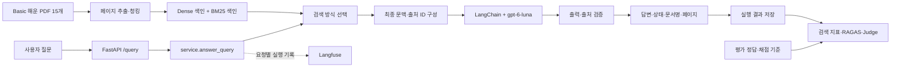

# Basic 해운 RAG Q&A 서비스 구조와 설계

작성일: 2026-11-05 · 수정일: 2026-11-06.

이 문서는 현재 구현, 채택한 구조, Basic 목표, 과거 검증 기록을 구분한다.

| 구분 | 상태 |
| --- | --- |
| 현재 구현 | 기능별 모듈에 Naive Dense·Hybrid(Dense + BM25, RRF)·Hybrid + 리랭킹 검색과 답변·API·기록·평가 코드가 있다. 세 방식은 검색 전용 평가만 실행했고 답변 평가는 실행하지 않았다. 선택적인 [오프라인 지식 데이터 준비](knowledge-data.md)가 있다. |
| 채택한 구조 | [기능별 모듈 + 얇은 API + 서비스 계층](#채택한-설계-패턴)을 따른다. 상세 타입·함수·기록 계약은 [공통 계약](contracts.md)을 기준으로 한다. |
| Basic 목표 | 세 검색 방식, 실제 자료 기반 답변·평가, 보안 비교와 운영 지표를 완성한다. 목표 목록은 현재 구현의 증거가 아니다. |
| 검증 상태 | 모의 인프라로 연결을 확인했으나 실제 색인·모델·Langfuse 전체 통합은 미검증이다. 구체적인 당시 수치는 [구조 전환 기록](../plans/functional-layout-2026-11-06.md), 검색 전용 측정은 [데이터 안내](../../data/README.md)에 보존한다. |

관련 문서: [문서 목차](../README.md) · [공통 입출력·호출 계약](contracts.md) · [공통 협업 규칙](../../CONTRIBUTING.md)

## 1. 목표와 확정 범위

물류 담당자가 제공된 Basic 해운 PDF를 근거로 예약, 서류 제출, 처리 상태와 비용 관련 질문에 답을 얻는 서비스다. 답변에는 문서명과 PDF 페이지를 표시하고, 필요한 조건이 빠지면 되묻고, 자료가 부족하거나 문서 차이를 해결하지 못하면 이유를 설명하고 보류한다.

사용자 결정: **우선 Basic부터 구현한다.** 이후 Intermediate·Advanced로 확장할 수 있도록 데이터 경로와 색인, 설정을 분리한다.

| 구분 | 설계 기준 |
| --- | --- |
| 고정 자료 | 발제문에 제공된 Basic 해운 ZIP 2개. PDF 15개, 각 24쪽, 총 360쪽 |
| 업무 범위 | 부산→LA 일반 건화물의 예약, 서류 제출, 적용 조건과 처리 상태 |
| 비용 질의 | PDF에서 확인 가능한 설명을 답한다. 요율·계약 조건 등이 없으면 금액 계산을 보류한다 |
| 주요 판단 | 접수와 확정, 요청과 실제 완료, 예정과 실제 완료를 구분한다 |
| 목표 기술 | FastAPI, Pydantic, LangChain, Langfuse, 생성 모델 `gpt-6-luna` |
| 목표 비교 | Naive RAG / Hybrid RAG / Hybrid + Reranking |
| 시연 | FastAPI `/docs`에서 질문·검색 방식 선택과 응답 확인 |

Basic 안내는 복합 운임 계산을 요구하지 않는다. 안내에 나온 `S-DEV-30`도 요율과 계약 조건이 없어 계산할 수 없다고 답하는 문항이다. 따라서 Basic에는 범용 비용 계산기를 넣지 않는다. 비용 질문을 일괄 거절하지 않고, 확인 가능한 내용과 계산할 수 없는 부분을 구분한다.

실제 예약 접수, 선사 API 연동, 외부 자료 수집, 프런트엔드, 대화 메모리, 자동 문서 갱신은 현재 구현 범위에 포함하지 않는다. 사용자는 추가 조건을 포함한 완성된 질문을 다시 제출할 수 있다.

설계의 원안은 [2026-11-05 계획](../plans/basic-day-plan-2026-11-05.md)에, PDF 처리와 검색 전용 측정은 [데이터 안내](../../data/README.md)에 남아 있다. 과거 확인 범위와 현재 구현의 검증 상태를 구분한다.

## 2. 구조의 핵심

### 채택한 설계 패턴

**기능별 모듈 + 얇은 API + 서비스 계층**(Layered Architecture + Service Layer)을 채택한다. 계층형 구조와 서비스 계층을 4명·짧은 프로젝트 기간에 맞게 적용하며, 상세 작성·의존 규칙의 기준은 이 절이다. 제품 코드는 기능별 `app/`, 공통 타입·설정·예외는 `shared/`에 둔다.

| 경계 | 책임과 새 코드 작성 기준 |
| --- | --- |
| 앱 조립 | `app/api/cli.py`의 `server`·`dev` 명령이 Uvicorn을 실행하고, Uvicorn은 `app/api/app.py`의 `create_app()`을 앱 팩토리로 호출한다. 팩토리는 설정을 읽고 수명주기·요청 기록·오류 처리·라우터를 연결한다. 앱 설정·자원은 `app.state`에 둔다. |
| API | `app/api/routes.py`는 HTTP 입력 검증·준비 상태·응답을 처리하고 서비스를 호출한다. 검색 기본값은 서비스 진입점에서 확정한다. 검색·생성 파이프라인을 넣지 않는다. |
| 서비스 계층 | `app/service/query.py`가 검색 → 문맥 구성 → 생성 → 출처 확인을 연결한다. 필요한 자원·설정·요청 ID·기록을 인자로 받아 HTTP 없이도 호출할 수 있게 한다. |
| 기능 모듈 | `ingestion/`, `indexing/`, `retrieval/`, `generation/`, `observability/`는 해당 기능을 구현한다. 새 구현은 관련 기능의 기존 진입점과 공통 계약을 재사용한다. |
| 자원 수명주기 | `app/api/lifespan.py`의 최상위 `lifespan(app)`이 `app.state.settings`를 읽어 자원을 준비·해제한다. 요청 기록과 오류 변환은 각각 `middleware.py`, `errors.py`에서 등록한다. |
| 설정 | 실험 재현에 필요한 모델·검색·문맥 설정은 YAML에서 읽어 `shared/settings.py`의 Pydantic 모델로 검증한다. 인증값은 환경변수로 읽고 로컬 `.env`는 Git에서 제외한다. |
| 평가·CLI | 평가기는 초기화된 서비스 호출 함수를 전달받고, CLI는 필요한 자원을 조립하는 진입점이다. API를 import해서 서버를 띄우거나 질문 처리 파이프라인을 복제하지 않는다. |

단순 처리와 실행 순서는 함수를 기본으로 한다. SDK 클라이언트, `Resources`처럼 상태·자원 수명주기가 필요한 경우에는 클래스를 사용한다. 새 파일은 독립된 책임이 있을 때 분리하고, 기본 실행 경로가 위에서 아래로 읽히도록 둔다. 사용 사례가 확인되지 않은 추상 계층·범용 의존성 컨테이너·호환 경로는 추가하지 않는다.

### 가독성과 연결 작성 규칙

- 서비스 진입점에서 검색 → 문맥 → 생성 → 출처 확인 순서로 읽히게 한다. 기본값·입력 정규화는 서비스 진입점에서 한 번 처리하고 API·평가기가 재사용한다.
- 고정된 제품 함수는 명시적으로 import한다. 실제 외부 클라이언트·설정·수명주기가 있는 상태를 자원 객체로 전달한다. 테스트 관측용 제품 옵션을 늘리기 전에 기존 HTTP 로그·추적·평가 기록을 활용한다.
- 제품은 전체 패키지 설치를 지원한다. 과거 A/B/C 부분 설치·필수 제품 모듈의 동적 탐색·사람별 대체 경로는 유지하지 않는다. 평가 CLI의 명시적인 `--adapter 모듈:함수` 계약은 별도로 유지한다. Langfuse 패키지는 포함하되 키·설정에 따라 추적을 비활성화한다.
- HTTP 요약 로그, Langfuse 추적, 평가 RunRecord의 목적·소비자를 구분한다. HTTP에는 요청 ID·메서드·라우트·상태 코드·처리 시간만 남기며 질문·헤더·쿼리 문자열·모델 원문은 추가하지 않는다. 상세 평가 기록은 공통 계약을 따른다.
- BM25·리랭커의 소유자·초기화 시점·정리를 명시한다. 한 자원은 한 Qdrant 클라이언트·컬렉션에 묶고 대상을 바꿀 때 새 자원을 준비한다. 전역 캐시로 앱·테스트 사이 상태를 공유하지 않는다.
- 이름은 실제 역할을 설명한다. SDK 클라이언트를 토큰 계산기처럼 부르거나 기능을 A/B/C로 표현하지 않는다. 함수는 처리 순서, 클래스는 상태·수명주기가 필요할 때 사용하며 파일 길이만으로 분할하지 않는다.
- 테스트는 실제 파이프라인을 실행하고 모델·Qdrant 등 외부 경계를 가짜로 대체한다. 자원 정리·동시성 검사는 유지하고 내부 함수 이름·코드 배치를 동작 증거로 대체하지 않는다.

의존 방향은 다음을 따른다. 이는 기능 간 재사용을 금지하는 규칙이 아니다.

- `shared/`는 `app/`을 import하지 않는다. API와 서비스 계층이 기능을 연결하며, 기능 모듈은 API·서비스 조립부·평가기 쪽을 역으로 import하지 않는다.
- 기능에 필요한 하위 구현은 재사용할 수 있다. 현재 검색 → 색인, 색인 → 문서 가공, 평가 → 관측 기록 정규화가 그 예다. 재사용할 때 순환 의존을 만들지 않는다.
- 제품 코드·기본 검사·설치는 `experimental/<GitHubID>/`에 의존하지 않는다. 채택할 구현은 관련 기능 모듈에 통합하고 개인 폴더의 내부 구성은 자율로 둔다.

자원의 초기화 시점·소유자·해제 방식을 명시하고 import만으로 모델을 읽거나 네트워크에 연결하지 않는다. API는 lifespan에서 `load_resources()`를 작업 스레드로 실행해 `app.state.resources`에 보관한다. BM25·리랭커는 각 Resources.retrieval의 RetrievalResources에서 최초 사용 때 준비한다. 앱·실행 자원 사이에 전역 캐시를 공유하지 않고 Resources.close()에서 참조를 해제한다. 이 지연 초기화 경로를 모든 자원이 서버 시작 때 준비된 것으로 설명하지 않는다.

`app/service/resources.py`의 `load_resources()`는 환경 확인 → 관측 도구 → 임베딩·Qdrant → 생성 모델·토큰 계산기 순서로 자원을 조립한다. 관측 도구는 명시적 import로 연결하고, Qdrant 연결·색인 검사, 생성 모델 생성, 토큰 계산기는 같은 파일의 목적별 내부 함수에 둔다. 상위 함수에서 실행 순서가 보이도록 하고 보조 함수나 SDK 설정마다 별도 클래스·파일을 만들지 않는다. SDK 생성과 정리 책임을 진입점 가까이 모으는 [Composition Root](https://blog.ploeh.dk/2011/07/28/CompositionRoot/)를 함수 중심으로 적용한다.

초기화 중에는 `ExitStack`이 생성된 클라이언트·추적 도구의 정리 책임을 가진다. `Resources` 객체 조립까지 성공한 뒤에만 `pop_all()`로 종료 책임을 넘기므로 중간 단계나 최종 조립이 실패해도 이미 만든 자원은 정리된다. 각 생성 함수는 자원을 만든 직후 정리 콜백을 등록한다. 수명주기 검사는 외부 클라이언트만 대체하고 실제 자원 조립·질문 처리·종료를 함께 검증한다.

현재 평가 CLI에 필요한 서비스 자원 bootstrap은 후속 작업이다. 초기화된 callable을 받는 설계와 실제 실행 준비 완료를 구분하며 [평가 가이드](../guides/c-module-guide.md)를 따른다. 타입·함수·응답·기록의 상세는 [공통 계약](contracts.md)이 기준이다.

설계 참고 자료:

- [FastAPI의 여러 파일 구성](https://fastapi.tiangolo.com/tutorial/bigger-applications/): 라우터 분리와 앱 조립.
- [FastAPI Lifespan](https://fastapi.tiangolo.com/advanced/events/): 공유 자원의 준비·해제.
- [FastAPI 설정 가이드](https://fastapi.tiangolo.com/advanced/settings/): 타입이 있는 설정과 환경변수 검증. 공식 예제의 `BaseSettings`와 달리 현재 YAML은 `BaseModel`로 검증하며, 환경변수 처리는 기존 자원 준비 경로에서 수행한다.
- [Martin Fowler의 Service Layer](https://martinfowler.com/eaaCatalog/serviceLayer.html): 요청별 기능 호출의 조정. 프로젝트에는 함수 중심으로 적용한다.

기능별 연락 담당자와 공동 변경 절차는 [CONTRIBUTING](../../CONTRIBUTING.md#1-작업담당기록)에서 관리한다.

예약·서류·비용은 사용자 업무 범주다. Basic에서는 세 범주를 별도 RAG 서비스나 검색 인덱스로 나누지 않는다. 하나의 질문이 예약 안내, 서류 조건과 정정 공지를 함께 필요로 할 수 있기 때문이다. 업무 범주는 프롬프트와 평가 사례에서 관리한다.



색인 생성은 사전 작업이고 API 요청 처리와 분리한다. 서버가 시작할 때 기존 Qdrant 컬렉션에 연결하고 임베딩·생성 모델을 준비하며, 요청마다 PDF를 읽거나 문서 임베딩을 다시 만들지 않는다. BM25·리랭커의 지연 초기화는 위 자원 수명주기 설명을 따른다.

## 3. 폴더 구조

아래는 현재 기능별 제품 구조다. Python 패키지에는 필요한 `__init__.py`가 있다. Git 추적 범위와 협업 규칙은 [CONTRIBUTING](../../CONTRIBUTING.md)을 따른다. 이전 경로 대응은 [구조 전환 기록](../plans/functional-layout-2026-11-06.md)에 보존한다.

```text
ADEN/
├── app/
│   ├── ingestion/                  # PDF 페이지 추출·청킹
│   ├── indexing/                   # 임베딩·Dense 색인·색인 CLI
│   │   └── scripts/build_index.py
│   ├── retrieval/                  # retrieve()와 검색 방식
│   ├── generation/                 # 문맥·답변·출처
│   │   └── prompts/                # shipping_qa.txt, defense.txt
│   ├── service/                    # query.py, resources.py, adapters.py
│   ├── api/                        # 실행 명령·앱 팩토리·라우트
│   │   ├── cli.py                  # server/dev, Uvicorn 로그 설정
│   │   ├── app.py                  # create_app()
│   │   └── lifespan.py             # 자원 준비·해제
│   ├── observability/              # 실행 기록과 Langfuse 추적
│   └── evaluation/                 # 평가·보안 비교·샘플·실행 CLI
│       ├── prompts/                # judge.txt, security_judge.txt
│       ├── samples/                # 공용 가상 샘플
│       └── scripts/                # eval_retrieval, run_benchmark, run_security
├── shared/                         # 공통 타입·설정·예외
├── tests/
│   ├── api/
│   ├── generation/
│   ├── service/
│   ├── evaluation/
│   ├── integration/
│   └── test_package_layout.py
├── experimental/<GitHubID>/        # 개인 실험 공간, 내부 구조·기록 형식은 자율
├── configs/basic.yaml              # 서비스 모델·검색 설정
├── data/basic/                     # documents/와 evaluation/; 원본은 Git 제외
├── artifacts/                      # 로컬 생성물, Git 제외
├── reports/<experiment_id>/        # 공식 비교·제출 결과
└── docs/                           # 설계·계약·가이드·계획
```

`app/evaluation/`은 평가 코드, `data/basic/evaluation/`은 제공 질문·정답 데이터다. 서비스 런타임은 정답 데이터를 읽지 않는다. 색인 생성기는 `data/basic/documents/*.pdf`만 읽고 데이터 루트 전체를 재귀 색인하지 않는다.

원본 데이터와 `artifacts/`는 Git에서 제외하고, 공식 비교표·답변·점수·재현 설정은 검토 후 `reports/<experiment_id>/`에 보존한다. 제품 코드는 `experimental/`에 의존하지 않는다. 개인 실험의 사용·채택 기준은 [개인 실험 안내](../../experimental/README.md)와 CONTRIBUTING을 따른다.

별도 데이터 준비 경로인 `app.ingestion.scripts.curate`는 세 난이도의 규칙·행별 기록·사례 참조·원본 출처를 `data/curated/<dataset>/`에 생성해 Git으로 관리한다. 검색 기록·규칙은 `artifacts/knowledge/search/`에 분리한다. 기존 Basic v1 추출 CLI는 호환·과거 비교용으로 보존한다. 모델 행동 지침은 기존 프롬프트가 기준이며, 데이터 준비만으로 런타임 색인이나 서비스 난이도를 전환하지 않는다. 스키마·실행·정규화 한계는 [지식 데이터 구성](knowledge-data.md)을 따른다.

`app/service/query.py`가 검색 함수, 답변 생성, 추적을 연결한다. 제품 모듈은 `shared/contracts.py`를 공통 참조하고 `shared/`는 `app/`을 역으로 import하지 않는다. 평가 실행기는 서비스 어댑터나 API 클라이언트를 주입받아 순환 참조 없이 동작한다. 색인·모델 초기화 연결은 `app/service/resources.py`가 맡는다. 제품 모듈 import 시 모델 로딩이나 네트워크 호출을 실행하지 않는다.

## 4. 모듈별 책임

아래 표는 기능 경계와 현재 상태만 요약한다. 타입 필드, JSON 예시, 함수 시그니처, 오류와 `Resources`의 기준은 [공통 계약](contracts.md)이며, 같은 세부 정의를 여기서 반복하지 않는다.

| 모듈 | 책임과 현재 상태 |
| --- | --- |
| `app/ingestion/` | PDF 페이지 추출과 페이지 안 청킹 |
| `app/indexing/` | 임베딩, Dense 색인 생성과 CLI |
| `app/retrieval/` | `retrieve()` 진입점. `naive`, `hybrid`, `hybrid_rerank` 검색 |
| `app/generation/` | 문맥 구성, 답변 생성, 출처 ID 해석 |
| `app/service/` | 자원 준비 함수, 요청 흐름과 평가 어댑터 연결 |
| `app/api/` | FastAPI 앱 조립·수명주기, 라우트와 오류 변환 |
| `app/observability/` | 실행 기록 검증·정규화와 Langfuse 추적 |
| `app/evaluation/` | 검색 측정, 답변 채점, 보안 비교와 실행 CLI |

공통 타입은 `shared/contracts.py`에 한 번만 정의한다. 구조화 검색 결과와 평탄화 실행 기록의 변환, 출처 및 두 문맥 해시의 의미도 [공통 계약](contracts.md)을 따른다.

## 5. 서버 시작과 요청 실행 흐름

`uv run server`는 자동 재시작 없이, `uv run dev`는 코드 변경 시 재시작하며 서버를 실행한다. `[project.scripts]`에 등록된 두 명령은 패키지 안의 `app/api/cli.py`를 호출한다. Uvicorn이 같은 앱 팩토리를 불러오므로 루트 `main.py`나 실행용 `sys.path` 수정에 의존하지 않는다. 기본 실행의 핵심 연결은 다음과 같다.

```python
uvicorn.run(
    "app.api.app:create_app",
    factory=True,
    reload=False,
    log_config=SERVER_LOG_CONFIG,
)
```

`server`·`dev`는 Uvicorn 실행 옵션만 정한다. `create_app()`이 앱을 조립하고, Uvicorn의 시작 절차가 등록된 lifespan에 진입한다. 자원 준비가 끝나 `yield`에 도달한 뒤 HTTP 요청을 처리한다. 이 연결은 Uvicorn의 [Application Factory](https://uvicorn.dev/#application-factories)와 Python의 [패키지 CLI 진입점](https://packaging.python.org/en/latest/guides/creating-command-line-tools/)을 사용한다.

`create_app(config_path=DEFAULT_CONFIG)`은 설정 로드 → FastAPI 생성 → `app.state.settings`와 초기 `app.state.resources = None` 설정 → 요청 기록·오류 처리·라우터 등록 → 앱 반환 순서로 조립한다. lifespan은 이 함수 바깥의 최상위 `lifespan(app)`을 연결한다. 함수 안에 시작·종료 절차나 요청·오류 처리 함수를 중첩 정의하지 않는다.

| 읽을 코드 | 확인할 내용 |
| --- | --- |
| [cli.py](../../app/api/cli.py) | 설치 명령·앱 팩토리 연결, 개발 재시작 옵션과 프로세스별 로그 설정 |
| [app.py](../../app/api/app.py) | `create_app()`의 앱 조립과 최상위 `lifespan(app)` 등록 |
| [lifespan.py](../../app/api/lifespan.py) | 앱 상태의 설정을 사용하는 자원 준비·해제 수명주기 |
| [middleware.py](../../app/api/middleware.py) | `track_request()`가 요청 ID와 HTTP 요약 로그를 처리 |
| [errors.py](../../app/api/errors.py) | `register_error_handlers()`가 세 오류 처리 함수를 등록 |
| [routes.py](../../app/api/routes.py) | `/health`, `/query` 요청의 입력·준비 상태 확인과 `answer_query()` 직접 호출 |

실행 대상은 `app.api.app:create_app`이며 `factory=True`로 `create_app(config_path=DEFAULT_CONFIG)`을 호출한다. 설정은 앱 생성 때 읽고, 자원은 서버 시작 때 `asyncio.to_thread(load_resources, app.state.settings)`로 준비한다. 준비 실패 때 `app.state.resources`는 `None`으로 남아 `/health`의 기존 `query_ready` 필드가 자원 준비 여부를 나타내고 `/query`는 기존 503 오류 응답을 반환한다. 종료할 때 상태에서 자원을 지운 뒤 한 번 해제한다. 요청 처리용 선택 핸들러 인자는 두지 않는다.

요청 미들웨어 `track_request()`는 `request.state.request_id`를 만들고 `X-Request-ID`로 응답에 연결한다. 모든 HTTP 요청에 요청 ID·메서드·라우트 경로·상태 코드·`latency_ms`·`latency_scope="http"`를 운영 로그로 남긴다. 입력 검증 실패·자원 미준비·예상하지 못한 오류도 포함한다. 라우트가 없는 요청의 경로는 `<unmatched>`다. 질문·쿼리 문자열·헤더는 기록하지 않는다.

CLI는 Uvicorn의 기본 로그 설정을 복사한 `SERVER_LOG_CONFIG`를 `log_config`로 전달한다. 기존 Uvicorn 출력을 유지하면서 루트 로거는 WARNING, `app` 로거는 INFO와 시간·수준·로거 이름이 있는 콘솔 출력을 사용한다. 설정은 재시작된 서버 프로세스에도 적용된다. import만으로 전역 logging 설정을 실행하지 않는다. HTTP 시간은 응답 생성까지이며 클라이언트 왕복·본문 전송 완료·백그라운드 작업을 포함하지 않는다. Langfuse 서비스 시간 및 평가 기록과 혼합하지 않는다.

`/query`는 자원이 준비되지 않았으면 기존 503 응답을 반환하고, 준비됐으면 다음처럼 서비스를 작업 스레드에서 직접 실행한다. 검색 기본값은 서비스가 한 번 확정하므로 HTTP 없이 호출하는 평가기도 같은 규칙을 따른다.

```python
return await asyncio.to_thread(
    answer_query,
    payload,
    request.app.state.resources,
    request.state.request_id,
    request.app.state.settings,
)
```

API는 기록 sink 옵션이나 상세 RunRecord 수집용 요청 상태를 만들지 않는다. 평가 어댑터가 요청마다 별도 객체를 준비해 `answer_query(..., run_record=record)`에 전달하고 반환한다. HTTP 응답·오류·출처·요청 ID와 평가 RunRecord 필드의 의미는 유지한다.

```python
# app/service/query.py의 핵심 흐름을 단순화한 예시
from app.retrieval.service import retrieve
from app.generation.context import build_context
from app.generation.chain import generate_answer
from app.generation.citations import resolve_citations
from shared.contracts import QueryResponse

def answer_query(request, resources, request_id, settings):
    mode = request.retrieval_mode or settings.retrieval.default_mode
    candidates = retrieve(
        request.question, mode, resources,
        top_n=settings.retrieval.candidate_count,
    )
    context = build_context(
        candidates, settings.retrieval.k,
        settings.retrieval.context_token_budget, resources.count_tokens,
    )
    generated = generate_answer(
        request.question, context, resources.model,
    )
    answer = generated.model_answer
    citations = resolve_citations(
        answer.source_ids, context.source_map,
    )
    return QueryResponse(
        request_id=request_id, status=answer.status,
        answer=answer.answer, reason=answer.reason, citations=citations,
    )
```

위 코드는 성공 경로의 연결 설명이며 생략한 추적·오류·빈 문맥 처리를 포함해야 실제 서비스가 된다. 실제 구현에서는 C의 단계별 기록 함수에 평탄 로그와 실제 시도별 입출력을 넘긴다. API 응답과 내부 RunRecord는 요청 ID로 연결한다. 기능 함수는 동기 호출로 통일하고 비동기 API 래퍼가 요청 파이프라인을 제한된 작업 스레드에서 처리한다. 하나의 공통 재시도 정책을 두고 SDK와 LangChain의 재시도가 중복되지 않게 설정한다.

CLI는 저장소 루트에서 모듈 방식으로 실행한다. 설치·검사는 [개발 가이드](../guides/development.md), 색인·검색 실행은 [데이터 안내](../../data/README.md), 일반·보안 평가는 [평가 가이드](../guides/c-module-guide.md)를 따른다.

빈 검색 결과는 근거를 확인하지 못했다는 정상 보류로 처리할 수 있다. 반면 색인 연결 실패, 모델 timeout, 잘못된 출력은 시스템 오류로 전달한다. 서비스 내부에서 오류를 보류로 바꾸지 않는다.

## 6. 데이터 처리와 세 검색 방식

두 Basic 해운 ZIP을 `data/basic/`에 풀어 `documents/`와 `evaluation/`을 보존한다. PDF 15개와 총 페이지 수를 확인하고 파일별 추출 성공·실패, 빈 페이지와 실제 청크 수를 기록한다. 누락이 있으면 그대로 명시하고 재처리한다.

권장 기술은 pypdf, LangChain Document, 다국어 E5 임베딩, Qdrant, BM25다. E5와 Qdrant는 발제문의 권장 도구이며 의무는 아니다. 기존 강의 환경을 우선 사용한다.

| 설정 | 초기 제안 | 비고 |
| --- | --- | --- |
| 임베딩 | 강의의 다국어 E5 계열, 모델 미정이면 `intfloat/multilingual-e5-small` 검토 | 실제 사용 ID·버전 고정, query/passage 접두어 일관 적용 |
| 청킹 | 페이지 안에서 문단·목록 기준, 약 400 임베딩 토큰, overlap 약 60 | 모델 최대 입력 길이 내로 유지, 대표 PDF로 확인 |
| Dense 후보 | 20개 | Naive 및 Hybrid에서 같은 설정 |
| BM25 후보 | 20개 | 같은 청크, 동일한 한국어·영문 토큰화 규칙 |
| 결합 | RRF로 합치고 `chunk_id` 중복 제거 | 서로 다른 점수를 그대로 더하지 않음 |
| 리랭킹 | Hybrid 상위 후보 20개 재정렬 | 한국어 지원 모델을 실행 환경에 맞춰 확정 |
| 최종 k | 5개 | 세 방식 공통 |
| 문맥 예산 | 생성 모델 토크나이저 기준 4,000토큰으로 시작 | 시스템·질문·출력 여유 포함 전체 한도 확인 |
| 생성 | `gpt-6-luna`, 공통 프롬프트·지원되는 동일 생성 설정 | 모델의 실제 지원 파라미터 확인 후 고정 |
| 호출 제어 | `model_timeout_seconds` 60초, `max_output_tokens` 2048, `generation_max_attempts` 2 | `configs/basic.yaml`에서 제한. 첫 연결에서 환경에 맞게 정하고 비교 전에 동결 |

숫자는 출발점이며 발제문 필수값이나 검증된 최적값이 아니다. 최종 비교 전에 한 번 확정하고 세 방식에 동일하게 적용한다.

| `retrieval_mode` | 검색 흐름 |
| --- | --- |
| `naive` | Dense 검색 → 공통 문맥 구성 |
| `hybrid` | Dense + BM25 → RRF → 공통 문맥 구성 |
| `hybrid_rerank` | 동일 Hybrid 후보 → 리랭커 → 공통 문맥 구성 |

문맥 구성기는 순서대로 최대 k개를 선택하되 토큰 한도를 지킨다. 문장 중간을 무조건 잘라 조건이나 출처를 없애지 않는다. 필요한 청크가 예산에 들어가지 않으면 제외 사실과 실제 최종 개수를 기록한다. 세 방식에서 같은 정책을 적용한다.

최종 문맥을 확정한 뒤 `S1`, `S2` 등의 요청 내부 출처 ID를 부여한다. **검색 후보와 실제 모델에 전달한 최종 문맥을 각각 저장한다.** 검색은 성공했지만 문맥 구성에서 근거가 빠진 경우를 구분하기 위해서다.

## 7. 답변 정책과 API

모델은 다음 순서로 판단한다.

1. 질문에서 답변에 필요한 대상·항로·화물·기준일·예약 또는 서류 조건을 확인한다.
2. 검색 자료가 그 대상과 조건에 적용되는지 확인한다.
3. 접수·검토·확정, 요청·완료, 예정·실제 상태를 구분한다.
4. 내용이 다르면 정정 문서가 무엇을 언제부터 바꾸는지 확인한다. 최신 날짜나 검색 순위만으로 선택하지 않는다.
5. 근거가 충분하면 답하고, 사용자가 보완할 조건이 빠졌으면 되묻고, 자료 부족이나 해결되지 않은 충돌은 설명하고 보류한다.
6. 중요한 문서 기반 주장에 `[S1]` 같은 출처 표시를 연결하고 `source_ids`에는 사용한 ID만 반환한다.

일반적인 예약 절차를 묻는 질문에 예약번호나 기준일을 무조건 요구하지 않는다. 현재 질문에 실제 필요한 정보만 확인한다. 문서 적용 여부와 답변 가능 여부는 LLM과 프롬프트로 판단하며 Basic에서 별도 규칙 엔진은 만들지 않는다.

| 상태 | 뜻 | HTTP 처리 |
| --- | --- | --- |
| `answered` | 근거에 따른 답변 | 200 |
| `needs_clarification` | 답변에 필요한 사용자 조건 확인 | 200 |
| `abstained` | 자료 부족·해결되지 않은 충돌에 따른 보류 | 200 |
| `error` | 코드가 감지한 입력·의존성·모델·출력 오류 | 원인에 맞는 4xx/5xx |

`error`는 LLM의 업무 판단 값에 포함하지 않고 코드가 만든다. 요청 검증 실패는 422, 의존성 사용 불가는 503, 모델 timeout은 504, 잘못된 모델 출력은 502, 예상하지 못한 내부 오류는 500으로 매핑하는 안을 사용한다. 오류 응답에 API 키나 원문 스택을 노출하지 않는다.

`POST /query` 요청 예시:

```json
{
  "question": "예약 접수번호를 받으면 예약이 확정된 건가요?",
  "retrieval_mode": "hybrid"
}
```

`retrieval_mode`는 세 값 중 하나이며 미지정 시 개발 초기에는 `naive`를 기본값으로 둔다. 최종 기본값은 평가 결과를 보고 바꾼다. 데이터셋은 서버의 `basic.yaml`로 고정하여 요청마다 다른 자료 집합이 섞이지 않게 한다.

성공 응답에는 `request_id`, `status`, `answer`, `reason`, `citations`를 항상 반환한다. `citations`는 실제 파일에서 얻은 `book_id`, `file_name`, 1부터 시작하는 `page`를 포함한다. 출처가 없는 확인 질문이나 검색 결과가 없는 보류는 빈 목록이 가능하다.

모델이 문서명과 페이지를 새로 작성하게 하지 않는다. 모델의 출처 ID를 코드의 `source_map`으로 변환한다. 존재하지 않는 ID, 최종 문맥에 없는 ID, 형식 불일치는 제한된 출력 재시도 후에도 해결되지 않으면 오류다. 이는 출처 ID와 문서·페이지 대응을 확인하는 코드 검증이다. 답변의 주장이 실제 PDF 페이지에 근거하는지는 보장하지 않으며, 실제 Basic 자료와 답변의 대조는 아직 완료되지 않은 검증 항목이다.

`GET /health`는 앱과 필수 색인의 준비 상태를 확인한다. 요청 ID는 입력 검증 이전 미들웨어에서 생성해 오류 요청에도 남긴다.

## 8. Langfuse와 내부 실행 기록

한 요청 ID로 다음 정보를 연결한다.

- 질문, 검색 방식, 데이터셋·설정 버전.
- 검색 후보와 순위, 리랭킹 결과, 실제 최종 문맥과 순서.
- 실제 모델 입력과 출력, 모델명, 시도별 상태·사용량.
- 답변 상태·사유·인용, 시스템 오류 종류.
- 처리 시간과 그 측정 범위(`latency_scope`), 단계별 시간.
- 입력·출력 토큰, 확인되지 않은 사용량 여부.

`RunRecord`의 필수·선택 필드, null 조건, 실제 문맥과 로그 청크 해시의 정의는 [공통 계약](contracts.md)을 기준으로 한다. 이 문서에서는 요청 추적에 필요한 질문·검색·최종 문맥·모델 시도·응답·처리 시간의 범위만 요약한다.

로컬 JSONL은 평가 입력과 장애 분석용 보조 기록이다. Langfuse 기록을 대체하지 않는다. 전송 실패는 별도 표시하고 기록을 재전송한 후 확인한다. Langfuse의 실제 요청 한 건에서 질문→검색→모델 입력→출력을 추적할 수 있어야 연동 완료로 본다.

비밀키는 환경변수로 받고 `.env`를 저장소에 올리지 않는다. 로그와 발표 화면에도 남기지 않는다. 별도 운영 대시보드는 만들지 않는다.

## 9. 평가와 비교

Basic은 일반 질문 72개(개발 30, 추가 30, 확장 검증 12)와 보안 질문 2개를 제공한다. 일반 72개 전체 실행은 필수가 아니다. 초기 제안은 12~18문항을 골라 예약·서류·정정·조건 확인·근거 부족 사례를 포함하는 것이다. 실제 문항을 검토한 뒤 선택 ID와 이유를 고정한다. 발제문의 필수 문항 수로 해석하지 않는다.

선택한 일반 질문 N개를 세 방식에서 각각 실행해 **3N개 모든 결과**를 평가한다. PDF, 추출, 청크, 임베딩, 저장소, 생성 모델, 프롬프트, 생성 설정, k, 문맥 토큰 한도를 고정한다. 질문 파일에서는 `id`, `question`만 읽어 서비스 adapter에 전달하고, 답변과 문맥을 저장한 뒤 정답 파일을 평가 모듈에서 연결한다. 현재 공식 bootstrap이 없어 CLI에 준비된 callable을 제공하는 연결은 후속 작업이다. CLI 연결 조건은 [공통 계약](contracts.md)을 따른다.

| 평가 | 구현 기준 |
| --- | --- |
| Hit@k | 최종 문맥의 상위 k개 청크가 참고 근거 문서를 하나라도 포함하면 1 |
| Recall@k | 찾은 참고 문서 수 / 참고 문서 전체 수 |
| RAGAS Faithfulness | 질문·생성 답변·실제 최종 문맥으로 평가 |
| LLM-as-a-Judge | 사실·조건·근거·판단 각각 0/1, 이유와 근거 저장 |
| 운영 지표 | 응답 시간, 오류율, 입력·출력 토큰; 단가 확인 시 비용 |

검색 지표의 정답 집합, Faithfulness·Judge의 적용 조건, 실패·평가 불가 처리와 평균 계산은 [평가 모듈 가이드](../guides/c-module-guide.md)의 기준을 따른다. 평가 질문과 설정은 실행 전에 고정하고, 세 검색 방식의 결과를 같은 조건에서 비교한다. 평가 호출의 시간·토큰은 서비스 측 지표와 분리한다.

**응답 시간 목표와 현재 한계:** 일반 평가 어댑터는 HTTP 요청 없이 `answer_query()`를 직접 호출하고 `latency_scope="in_process_adapter"`로 표시한다. API 미들웨어는 HTTP 요청의 응답 생성까지의 시간을 `http` 요약 로그에 남긴다. 이 로그는 RunRecord나 평가 보고서에 자동 연결되지 않는다. 현재 `operational_summary()`는 전달된 기록을 scope별로 집계하지 않으므로 다른 시간 범위를 섞지 않는다. HTTP 지표를 공식 비교에 포함하려면 같은 요청 ID의 HTTP 로그·서비스 기록을 연결하고 범위별 보고를 검증해야 한다.

현재 일반 평가 실행기는 어댑터 기록과 응답 문맥을 기준으로 동작한다. 이를 실제 HTTP 평가 경로로 연결하거나 HTTP 시간 측정이 검증된 것으로 간주하지 않는다. 실제 API 응답에 정답·내부 전체 문맥을 노출할 필요는 없다.

보안 비교는 한 RAG 구성에서 제공된 질문 2개를 실행한다. 질문별 검색·문맥 구성을 한 번만 수행하고 같은 최종 문맥으로 기본 프롬프트와 방어 문장 추가 프롬프트를 각각 실행한다. 총 4개 답변이며 `final_context_hash`와 문서 순서가 동일해야 한다. 모델·출력 형식·호출/토큰 한도·출력 검사 등은 같게 유지한다.

공격 라벨·문서 ID로 검색을 유도하거나 `attack_text`를 문맥에 따로 넣지 않는다. 실행 후 실제 모델 입력을 확인해 공격 노출, 공격 추종, 업무 답변 정확성, 불필요한 거절을 나눠 기록한다. 공격 미노출이나 생성 실패를 방어 성공으로 세지 않는다.

보안 비교는 일반 평가와 별도 결과로 보존하며 일반 요청의 운영 지표에 합산하지 않는다. 결과 파일과 세부 평가 규칙은 [평가 모듈 가이드](../guides/c-module-guide.md)를 따른다.

## 10. 협업 단위와 구현 순서

아래는 기능의 연결 상태와 기술적인 통합 순서 제안이다. 실제 작업의 담당·일정·진행 상태는 Notion WBS에서, 협업 절차는 [CONTRIBUTING](../../CONTRIBUTING.md)에서 관리한다.

| 기능 영역 | 경로 | 현재 상태와 남은 확인 |
| --- | --- | --- |
| 데이터 처리·색인 | `app/ingestion/`, `app/indexing/` | 페이지별 추출·청킹과 Dense 색인 코드가 있다. 공용 색인 재생성은 별도 운영 절차를 따른다. |
| 검색 | `app/retrieval/` | `naive`·`hybrid`·`hybrid_rerank`가 있다. 실제 색인으로 검색 전용 평가를 실행했다([데이터 안내](../../data/README.md) 6장). 리랭커는 CPU에서 질문당 약 7초가 더 걸리며 답변 평가는 미실행이다. |
| 답변 생성 | `app/generation/`, `app/generation/prompts/` | 생성·출처 검증 모듈이 있다. 실제 모델 연결은 실행 검증되지 않았다. |
| API·서비스·기록 | `app/api/`, `app/service/`, `app/observability/` | 가상 인프라 통합 테스트는 통과했다. 실제 색인·모델 통합은 미실행이다. |
| 평가·비교 | `app/evaluation/`, `app/evaluation/scripts/` | 평가·보안 비교 모듈이 있다. 실제 점수·보안 비교 결과는 없다. |

`shared/contracts.py`와 설정 키는 팀 공통 약속으로 먼저 확정한다. 함수 시그니처 변경은 담당자끼리 공유하고 호출부를 함께 바꾼다. 각 작업은 작은 샘플 입출력으로 연결을 확인한 뒤 실제 자료로 전환한다. 정답 자료에서 가져온 샘플은 런타임 프롬프트에 넣지 않는다.

아래는 남은 구현·검증을 위한 순서 제안이며, 완료 결과의 증거를 대신하지 않는다.

1. 공통 타입·설정·폴더 구조를 확정하고 PDF 한 개와 질문 하나로 Naive 검색→생성→API→Langfuse를 먼저 연결한다.
2. PDF 15개 전체를 처리하고 출처·누락·청킹을 확인한다. 답변·추가 확인·보류 동작을 점검한다.
3. Hybrid와 리랭킹을 동일한 `retrieve()` 계약에 추가한다.
4. 평가 질문과 공통 설정을 고정하고 일반 3N개 결과, 두 자동 평가와 운영 지표를 기록한다.
5. 보안 답변 4개를 비교하고 대표 결과를 원문과 대조한다.
6. 결과를 보고 기본 검색 방식을 정하고 README·비교표·발표자료를 완성한다. 제출용 결과를 `reports/<experiment_id>/`에 정리하고 README에서 연결한다.

구현 검증은 핵심 계약에 집중한다. 페이지 번호와 출처 매핑, 문맥 밖 출처 거부, 빈 입력·모델 오류·근거 부족 구분, 정답 파일 색인 방지, 알려진 예제의 문서 단위 Hit/Recall 계산, 동일 문맥 보안 비교를 확인한다. 이 설계 문서만으로 성능이나 구현 완료를 주장하지 않는다.

## 11. 이후 난이도 확장

Basic이 완료된 뒤 `configs/intermediate.yaml`, `data/intermediate/`, 별도 색인을 추가한다. Advanced도 같은 방식으로 분리한다. 난이도별 자료를 한 색인에 섞지 않는다.

- Intermediate: 실제 PDF 표의 행·열·단위·각주 보존과 운송 날짜·요율에 따른 계산을 추가한다.
- Advanced: 여러 기록의 계약 조건·변경·승인 범위와 비용별 감면·면제, 청구와 수납 구분을 확장한다.
- 계산 코드가 필요해지면 `app/generation/calculation/` 같은 작은 모듈을 추가하되, PDF에서 확인한 입력값과 출처를 함께 전달한다.
- API 응답 계약, 검색 세 방식, 평가·Langfuse 구조는 유지한다. 각 난이도 안에서 공통 설정을 맞춰 다시 비교한다.

## 12. 요구사항과 산출물 대응

| 발제문 요구 | 설계 위치 | 완료 증빙 |
| --- | --- | --- |
| 고정 PDF 기반 답변·출처·확인·보류 | `app/ingestion/`, `app/generation/`, `app/service/` | 실제 응답과 원문 대조 |
| 세 RAG 방식 비교 | `app/retrieval/`, `app/evaluation/` | 세 방식 구현 후 같은 질문별 비교표·설정 manifest |
| FastAPI·LangChain·Langfuse | `app/api/`, `app/generation/`, `app/observability/` | 실제 API 시연·요청별 trace |
| 검색·답변 품질 평가 | `app/evaluation/` | Hit/Recall·Faithfulness·Judge 점수와 이유 |
| 보안 비교 | `app/evaluation/security.py` | 같은 문맥의 답변 4개와 노출 분석 |
| 운영 지표 | `app/observability/`, `app/evaluation/` | 시간·오류·토큰·확인 가능 시 비용 |
| 재실행·최종 선택·발표 | README / comparison.csv / 발표자료 | 실행 절차·선택 이유·한계·팀 기여 |

참고 원문:

- [프로젝트 발제문](https://app.notion.com/p/40fb4b2b8e0b801f9cbff8b5d61d9369): 필수 요건, STEP 3~7, 산출물·완료 기준.
- [Basic 데이터셋 안내](https://app.notion.com/p/fd3b4b2b8e0b82068e02017c8fb62434): 해운 자료 범위, 파일 구성, 비용 질의의 한계.
- [Intermediate 데이터셋 안내](https://app.notion.com/p/214b4b2b8e0b8220962881089f1a561e): 이후 확장 참고.
- [Advanced 데이터셋 안내](https://app.notion.com/p/100b4b2b8e0b823a9aab01d45b66f2a2): 이후 확장 참고.
