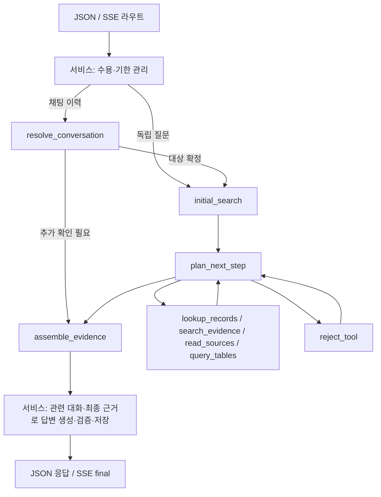

# 서버 코드를 따라 읽는 설계 기준

## 목표와 적용 범위

처음 읽는 사람이 질문 한 건의 처리 흐름을 코드에서 따라갈 수 있어야 한다. 현재 TableRAG API와 서버가 사용하는 검색·저장소·설정·추적을 검수한다. API·CLI·TableRAG 평가는 같은 요청 서비스를 사용한다. B/C 평가와 오프라인 구축은 지원 경계와 공통 호출의 호환성을 유지한다.

이 문서는 서버 구조의 기준이다. API·도구·저장 형식은 [공통 계약](contracts.md), 전체 구성은 [시스템 설계](architecture.md), 작업 상태와 검사 증거는 [진행 기록](../plans/advanced-rag/local-refactor-progress.md)에 둔다. 구현 함수와 검증 상태는 아래 읽기 안내와 진행 기록에서 확인한다.

## 검수 기준

- 정상 흐름에서 근거 확보 → 답변 생성 → 검증 → 저장 순서가 보인다.
- 이름만으로 요청 전체 실행, 계획, 도구 실행, 추적을 구분한다.
- 독립된 책임이 있는 함수만 분리한다. 줄 수를 줄이기 위한 전달 계층이나 범용 실행기를 추가하지 않는다.
- 공유 자원의 생성·종료 소유자가 하나이며, 요청 상태·사용량·추적은 요청마다 만든다.
- LangGraph의 경로는 그래프 정의에, 실제 모델 호출은 모델 모듈에, Langfuse 등록은 서비스의 요청 경계에 드러난다.
- 콜백은 프레임워크 연동과 스트리밍 알림에 사용한다. 서비스 내부 함수로 다시 돌아오는 계획 콜백을 두지 않는다.
- 모듈을 옮기거나 이름을 바꾸면 모든 제품 호출자와 문서 링크를 함께 갱신한다.
- 테스트는 응답·근거·호출량·오류·자원 수명과 실제 추적 산출물을 확인한다.

## 유지하는 동작

DB 우선 조회, KURE-v3와 KURE nano, Luna medium, 5:5 RRF·exact 검색, 후보 20쪽·최종 8쪽·8,000토큰을 유지한다. 요청별 근거 확인 기능을 추가하지 않는다. HTTP/SSE·SQL 제한·설정 우선순위·원자적 저장을 유지한다. 현재 로컬 GPU 및 운영 CPU 설정과 완성된 데이터 번들을 변경하지 않는다.

## 추적과 평가

공식 Langfuse CallbackHandler가 그래프·모델 실행을 기록한다. 요청 루트와 최종 근거의 정규화 기록은 평가 소비자가 읽는 계약으로 유지한다. 로컬 사용량과 실행 기록은 원격 수집 성공 여부와 독립적이다. 내부 추론·인증값·원시 예외 본문은 export 전에 가린다.

참고답과 평가는 검색 입력에 넣지 않는다. Ragas와 Judge는 저장된 실제 답변·최종 근거를 읽으며, 점수는 원래 trace에 연결한다. 기록 생성과 원격 저장 확인을 구분한다.

### 최종 답변과 판단 이유

제품 TableRAG는 [answer.txt](../../app/rag/prompts/answer.txt)를 사용한다. 기존 B/C 평가의 `shipping_qa.txt`와 별도이며, 검색 계획 지침을 최종 답변 모델에 그대로 넘기지 않는다. 서비스는 질문·최종 원문·SQL·검색 상태와 함께 충돌 항목·종료 사유를 `retrieval_diagnostics`로 전달한다. 검색 단계의 자유 서술 요약은 진단 기록에만 보관하고 답변 모델에는 전달하지 않는다. 요약에 최종 문맥 밖의 사실이 섞일 수 있기 때문이다. 전달된 진단과 대화 이력도 사실 근거가 아니며, 사실은 이번 최종 원문·SQL로만 뒷받침한다.

답변은 대상·기준 시각·정정 효력, 청구액과 검산, 확인된 항목과 보류 항목을 구분한다. 검색 상태의 보수적인 제한은 유지한다. `insufficient` 상태에서도 확인된 부분을 설명할 수 있지만 전체 API 상태는 `abstained`이며, 검색 판단을 임의로 `answered`로 올리지 않는다. 인사·업무 범위 안내에는 인용을 강제하지 않고 실제 예약·메일·송금 실행을 주장하지 않는다.

모델이 반환한 `reason`은 업무상 판단 이유와 미확인 범위를 담고 기존 HTTP/SSE의 `reason`으로 전달된다. 빈 이유는 검증 오류다. `reason`은 숨겨진 추론이 아니며 상세 사고 과정을 요구하지 않는다. SSE의 텍스트 조각은 기존처럼 `answer`만 보내고 `reason`은 최종 응답과 저장 기록에 담긴다. 출처 ID 검증은 유지하지만 의미상 근거 충족을 보장하는 검사는 아니므로 저장된 답변의 별도 평가가 필요하다. [고정 근거 비교 기록](../../experimental/u_10o0o/records/advanced-answer-policy-20261113/protocol.md)

## 참고 자료

- [LangGraph의 상태·노드·Runtime context](https://docs.langchain.com/oss/python/langgraph/graph-api)
- [Langfuse의 LangChain·LangGraph 공식 콜백](https://langfuse.com/integrations/frameworks/langchain)
- [Langfuse export masking](https://langfuse.com/docs/observability/features/masking)

## 정상 요청을 읽는 순서

1. [앱 수명주기](../../app/api/lifespan.py)가 설정을 해석하고 [초기화 모듈](../../app/rag/bootstrap.py)의 load_service로 공유 모델·검색기·SQLite·Langfuse를 준비한다.
2. [JSON 라우트](../../app/api/routes.py)의 query 또는 [SSE 라우트](../../app/api/chat.py)의 query_stream에서 질문과 요청 ID를 받는다. SSE는 헤더를 보내기 전에 실행 자리를 예약한다.
3. [요청 서비스](../../app/rag/service.py)의 ainvoke가 준비 상태와 처리 시간을 검사한다. 실제 질문 처리는 _answer_question에서 읽는다.
4. _answer_question의 langfuse_handler 생성과 langchain_config가 공식 추적의 등록 위치다. 질문·근거·모델 호출을 같은 trace로 묶는다.
5. [그래프](../../app/rag/graph.py)가 채팅 이력이 있으면 `resolve_conversation`에서 대상과 조건을 먼저 해석한다. 해석된 질문으로 `initial_search`를 실행한 뒤 모델이 고른 도구를 호출한다. 도구 노드는 [처리 함수](../../app/rag/tool_handlers.py)에 필요한 입력을 직접 전달한다.
6. [모델](../../app/rag/model.py)의 plan과 answer에서 LangChain 호출과 응답 검증을 확인한다. 모델 출력 일부를 화면에 보내더라도 완성된 답변의 검증을 생략하지 않는다.
7. [결과 변환](../../app/rag/result.py)이 최종 문맥에 포함된 출처만 인용하도록 검사한다. 서비스가 [실행 기록 저장](../../app/observability/run_store.py)을 마치면 JSON 응답 또는 SSE final을 반환한다.

`resolve_conversation`은 최근 2턴을 먼저 해석한다. 모델이 이전 맥락을 요청하면 같은 요청의 더 오래된 턴까지 한 번 확인한다. 그래프의 `messages`에는 이번 요청의 계획과 도구 결과가 들어간다. 답변은 `answer_history`에 고른 대화를 사용자·어시스턴트 메시지 순서로 받고, 원문·SQL은 기존 `evidence`에 담는다. 인용 검사와 평가는 이번에 확보한 근거를 사용한다.

### 채팅 한 건을 함수 순서로 따라가기

처음에는 준비된 서비스로 들어오는 정상 요청부터 읽는다. 초기화와 취소 세부 구현은 아래 흐름을 확인한 뒤 읽어도 된다.

| 순서 | 열어 볼 함수 | 이 지점에서 확인할 것 |
| --- | --- | --- |
| 1 | [chat.query_stream](../../app/api/chat.py#L132) | 질문·요청 ID를 받고 서비스의 실행 자리를 예약한다 |
| 2 | [chat._stream_query_events](../../app/api/chat.py#L169) → [_produce_query_events](../../app/api/chat.py#L266) | 전송 큐를 만들고 서비스의 ainvoke를 호출한다. event_sink는 큐에 넣는 알림 함수다 |
| 3 | [RagService.ainvoke](../../app/rag/service.py#L201) | 예약 소유권·기한·준비 상태를 확인하고 _answer_question으로 들어간다 |
| 4 | [RagService._answer_question](../../app/rag/service.py#L266) | 요청 추적과 ModelCalls를 새로 만든다. langchain_config에 공식 콜백을 등록한다 |
| 5 | [TableRagGraph.run](../../app/rag/graph.py#L885) → [_compile](../../app/rag/graph.py#L186) | run이 요청 State를 만들고 그래프를 호출한다. _compile에서 다음 노드로 가는 조건을 확인한다 |
| 6 | [TableRagGraph._initial_search](../../app/rag/graph.py#L280) | 이력이 있으면 [_resolve_conversation](../../app/rag/graph.py#L241)이 먼저 실행된다. 해석한 질문에서 코드를 읽고 공통 DB 또는 하이브리드로 첫 근거를 얻는다 |
| 7 | [TableRagGraph._plan_next_step](../../app/rag/graph.py#L423) → [TableModel.plan](../../app/rag/model.py#L261) | 계획용 메시지와 도구 스키마를 보내는 실제 LangChain ainvoke를 확인한다 |
| 8 | [lookup_records](../../app/rag/graph.py#L609) · [search_evidence](../../app/rag/graph.py#L638) · [read_sources](../../app/rag/graph.py#L658) · [query_tables](../../app/rag/graph.py#L702) | 선택된 노드가 인자를 검증한 뒤 해당 처리 함수를 직접 호출한다. 결과를 한 번 반영하고 재계획한다 |
| 9 | [TableRagGraph._assemble_evidence](../../app/rag/graph.py#L821) | finish가 고른 출처와 SQL을 예산 안에 조립하고 선택 출처의 유실을 검사한다 |
| 10 | [TableModel.answer](../../app/rag/model.py#L359) | 서비스가 선택된 이전 대화 메시지, 현재 질문, 최종 근거를 넘긴다. SSE에서는 stream_answer가 astream을 읽는다 |
| 11 | [validate_answer](../../app/rag/result.py#L29) | 최종 근거에 없는 인용과 종료 상태에 어긋난 답변을 거절한다 |
| 12 | [save_request_run](../../app/observability/run_store.py#L154) | 서비스가 원자적 저장을 마친 뒤 반환한다. _produce_query_events가 final을 큐에 넣는다 |

대화 해석, 계획, 답변의 로컬 사용량은 [ModelCalls](../../app/rag/model_usage.py#L47)에 쌓인다. 원격 기록은 [RequestTrace.langchain_handler](../../app/observability/tracing.py#L92)가 만든 공식 콜백이 맡는다. 두 책임은 분리되어 있어 Langfuse를 끈 상태에서도 실행 기록과 평가 입력은 남는다.

SSE의 큐는 서비스가 알린 진행 상태·답변 조각을 브라우저로 전달한다. 모델은 HTTP 연결을 소유하지 않는다. 요청 취소와 작업자 종료는 서비스가, 전송 종료와 예약 인계 전 해제는 SSE 응답이 맡는다.

## 코드와 Langfuse의 대응

| 코드에서 확인할 위치 | Langfuse에서 볼 대상 |
| --- | --- |
| 서비스의 요청 추적 시작 | rag-query 루트와 요청 ID |
| 그래프의 실제 등록 노드 | 대화 해석, 초기 조회, 다음 작업 계획, 선택한 도구, 근거 조립 |
| 모델의 plan / answer | planner-N / answer-N generation |
| 서비스가 기록한 검색·최종 근거 | retrieval / final-context |
| 별도 평가 CLI의 게시 | 원래 trace의 Ragas·Judge 점수 |

공식 콜백은 LangChain이 실행할 때 호출하는 추적 연결이다. 그래프와 모델에 전달하는 config에서 등록 위치를 확인한다. 도구는 그래프가 직접 호출하며 추적이 도구 실행을 대신하지 않는다.

서버 요청만으로 Ragas와 Judge가 자동 실행되지는 않는다. 저장된 실행을 [평가 CLI](../guides/c-module-guide.md#tablerag-평가)로 채점하고 별도 게시한다. 참고답이 없는 경우 Faithfulness를 사용할 수 있고, 참고답이 필요한 지표는 평가 불가 이유를 남긴다.

## 실패 흐름과 소유권

| 상황 | 책임과 결과 |
| --- | --- |
| 초기화 중 일부 자원 생성 실패 | 초기화 모듈이 이미 만든 자원을 역순으로 닫는다 |
| 대기열 초과·준비 실패 | 서비스가 모델 호출 전에 거절하며 API가 기존 HTTP 오류로 변환한다 |
| 잘못된 도구·인자·미관측 출처 | 그래프가 기존 오류 관측과 호출 횟수를 기록하고 정해진 재계획 경로를 따른다 |
| 모델 형식 오류·시간 초과 | 모델/서비스 오류로 기록하며 성공 응답을 만들지 않는다 |
| 진행 중 취소 | 동기 작업이 끝날 때까지 슬롯과 공유 자원을 유지한다 |
| 로컬 저장 실패 | 요청 실패로 처리하며 SSE final을 보내지 않는다 |
| Langfuse 장애 | 질문 처리를 계속하고 추적 상태와 오류를 구분한다 |

함수 이름 변경과 파일 분리는 내부 구조 변경이다. 기존 HTTP/SSE·CLI·실행 기록과 평가 입력은 [계약](contracts.md)을 따른다. 자동 추적 노드의 세부 트리는 달라질 수 있지만 요청 ID와 평가용 관측 연결은 유지한다.

## 현재 서버 전체 검수표

검수는 모듈별로 유지·변경 이유를 남긴다. 파일 수나 함수 길이만으로 분리 여부를 결정하지 않는다.

| 영역 | 판단과 조치 |
| --- | --- |
| API main/lifespan/middleware/routes/chat/errors | 앱 조립·HTTP/SSE·요청 ID 책임 유지. 오류 분류를 공유하고 채널별 메시지 보존 |
| 서비스·초기화·결과 변환 | 자원 준비와 요청 실행을 분리. 근거·답변·검증·저장 순서와 실패 기록을 명확히 함 |
| graph/state/tools/tool_handlers | 명시 도구 노드와 타입 있는 요청 context. 공통 결과 갱신은 한 번만 수행. 기록 관측 변환 중복 제거 |
| model/model_usage/streaming | 실제 모델 호출과 가시 출력 검증을 모델에 둠. 로컬 사용량과 공식 원격 추적 분리 |
| config/shared.settings | 현행 우선순위와 비밀값 제외를 유지. B/C 설정 설명의 API 표기를 정정 |
| corpus/models | 스냅샷·출처·벡터 정렬 검증과 mmap 소유권이 응집돼 유지 |
| retrieval/keyword_retriever | 하이브리드 순서와 BM25 계산 책임이 구분돼 유지. 모델·토큰·순위 변경 없음 |
| qdrant_index | exact 검색·동점 처리·컬렉션 검증 유지. upload/check가 직접 연 corpus를 실패 경로에서도 닫도록 보완 |
| records/table_store | 읽기 전용 스냅샷·출처 검증 및 제한 SQL·Decimal 계산 책임 유지 |
| evidence와 공유 generation.context/citations | 페이지 순서·예산·해시·인용 검증은 기존 함수 유지 |
| admission/readiness/lifecycle | FIFO·기한·단일 준비 검사·취소 후 정리 유지. 임시 파일 쓰기를 포함하는 readiness 설명 정정 |
| observability | 공식 콜백과 export 필터 추가. 평가용 정규화 기록·원자적 저장·점수 식별자 유지 |
| CLI·TableRAG 평가·HTTP 기록 복원 | 새 초기화 진입점과 콜백 형식을 연결. 과거 실행 기록 호환 검사 |
| B/C 내부·데이터 구축·웹·개인 실험 | 재설계하지 않음. 서버와 공유하는 경계의 호환성을 검사 |
