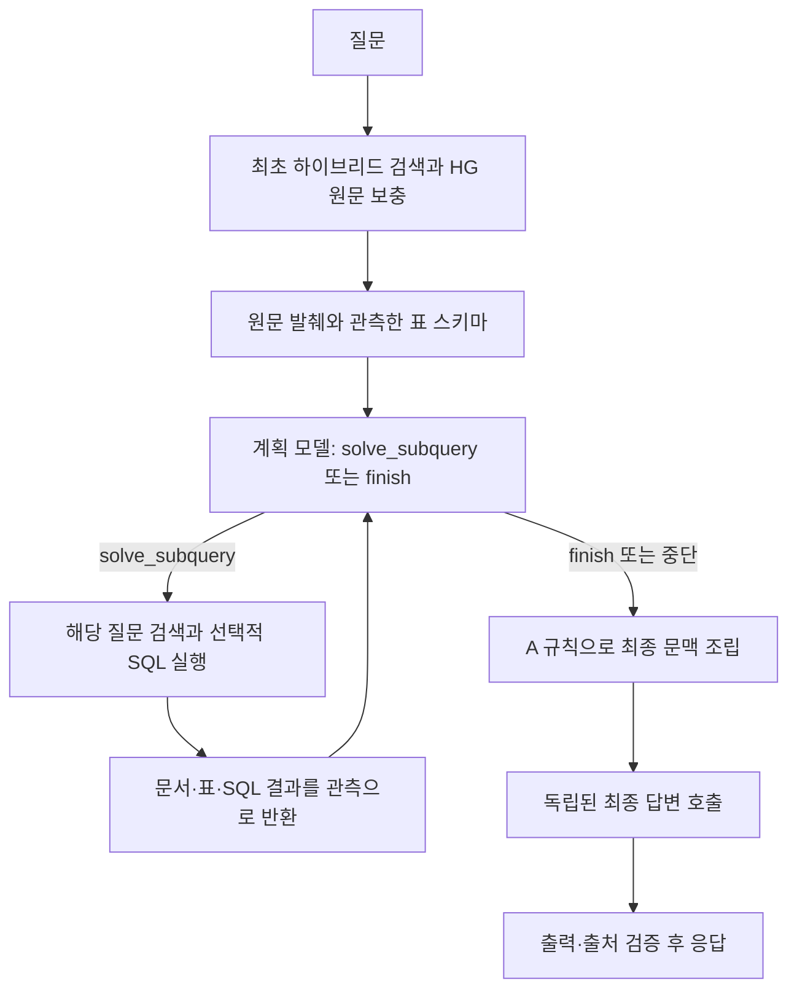

# 초기 TableRAG A 이식 계획 (이력)

> 2026-11-12 현재 구현 기준은 DB 우선 통합 TableRAG다. [현재 구현 기록](unified-implementation-log.md)과 [빠른 시작](../../guides/quickstart.md)을 따른다. 아래 A 이식 내용은 초기 설계 기록이다.

작성 2026-11-11 · 갱신 2026-11-12 · **TableRAG A 이식 설계**

사용자가 확인한 출발점은 **기존 TableRAG A(v5)**다. 검색·표 조회·반복 종료·최종 근거 구성은 A를 옮기고, 임베딩·리랭커 비교는 교체 경계 안에서 수행한다. 준비된 데이터는 [데이터 가이드](../../guides/data.md#advanced-tablerag-데이터)에서 불러온다. 현재 실행 방법은 [개발 가이드](../../guides/development.md#advanced-tablerag-실행)에서 확인한다.

| 읽을 내용 | 문서 |
| --- | --- |
| 유지할 동작과 목표 구조 | 이 문서 |
| 실제 작성 순서와 완료 조건 | [구현 로드맵](implementation-roadmap.md) |
| Langfuse·Ragas·Judge와 평가 절차 | [관측·평가 설계](evaluation-observability.md) |
| 코드 근거·공식 레퍼런스·결정 기록 | [근거와 결정](references-and-decisions.md) |
| 스냅샷·재생·제공자 연결 검증 | [이식 검증](verification.md) |

## 1. 범위와 호환 경계

| 구분 | 구현 기준 |
| --- | --- |
| 유지할 행동 | A의 원본 페이지·IS 표 내용 검색, HG 원문 보충, 관측한 표의 SQL, 도구 결과에 따른 후속 검색, A의 최종 문맥 구성 |
| 바꿀 내부 구조 | 실험 코드의 전역 경로·상속·가변 실행 기록을 제품용 모듈로 분리. 기존 서버의 클래스·서비스 함수에 맞출 의무는 없음 |
| 프레임워크 | LangChain의 Document·검색기·프롬프트·모델·도구 계약, LangGraph의 명시적인 반복 흐름, Langfuse 추적, Ragas 평가 |
| 모델 | 출발값은 KURE-v3 + KURE nano. 최종 선택은 남은 비교 후 확정. 모델 변경과 구조 이식을 같은 실험으로 섞지 않음 |
| 외부 계약 | 기존 응답 필드·상태·인용·요청 ID는 유지 우선. 요청에서 검색 방식을 제거하는 것은 별도 전환 항목 |
| 데이터 | 읽기 전용 원본·표·벡터 스냅샷. 색인은 오프라인 생성, 서버는 검증된 스냅샷만 로드 |
| 지원 밖 | 자유로운 DB 전체 탐색, 쓰기 SQL, 웹 검색, 임의 코드 실행, 장기 대화 기억, 자동 프롬프트 최적화·파인튜닝 |
| 미채택 비교안 | workflow의 별도 SQL 생성·중간 답변 LLM, B의 관측 출처 전체 보존, 새 요구사항 목록 판정 단계 |
| 기존 대안 | 실험 A와 현재 서비스는 이식 검증이 끝날 때까지 재현 가능하게 보존 |

용어상 HG는 예약·비용 사건 기록, HA는 업무 기록, IS는 업무 설명서·표를 가리키는 현재 실험의 분류다. 이 분류가 곧 검색 방법을 뜻하지는 않는다.

기존 서버를 교체할 수 있다는 허용은 불필요한 호환 클래스를 만들 필요가 없다는 뜻이다. 원본·실험 결과·팀원의 실행 경로를 먼저 삭제한다는 뜻은 아니다. 새 제품 경로에서 `experimental`을 import하지 않고 기능별로 옮긴다. 기존 코드는 호출처를 확인한 뒤 정리한다.

## 2. A에서 보존할 흐름



### 검색 한 번의 내부 흐름

1. 원본 페이지와 IS Markdown 표 본문을 같은 내용 검색 대상으로 삼는다. HG·HA 원본 페이지에서는 해당 물리 표로 연결한다.
2. 전체 코드를 보존하는 BM25와 제목 보너스, 벡터 검색이 각각 상위 50개를 반환한다.
3. 5:5 RRF, 상수 60으로 결합한다. **페이지와 그 페이지의 표가 두 자리를 차지하지 않도록 페이지 중복을 제거**하고 후보 20개를 남긴다.
4. 해당 검색 질문으로 KURE를 한 번 실행한다. 모든 결과를 합친 뒤 원질문으로 다시 리랭킹하지 않는다.
5. 기존 HG 대상·날짜 조회와 원문 보충을 적용한다. 이 부분을 생략하면 A의 이식이 아니다.
6. 순위·원본 출처·관련 표 ID·처리량을 반환한다. 스키마는 실제 발견한 표에서만 제공한다.

여러 검색 및 SQL 출처 묶음은 A의 순환 병합 순서로 합쳐 최종 후보 20쪽을 만든다. `finish.selected_sources`는 이 후보 안에서 반영한다. 후보 밖의 관측 출처를 다시 끌어오는 B 정책은 넣지 않는다.

### 도구와 모델 호출

| 항목 | 보존할 계약 |
| --- | --- |
| 계획 도구 | `solve_subquery(subquery, interim_summary, table_ids, sql)`와 `finish(status, selected_sources, interim_summary, conflicts)` |
| SQL 작성 시점 | 이미 앞선 관측에 나온 스키마로 작성. 새 표는 먼저 `sql=null`로 검색하고 다음 계획 호출에서 SQL 작성 |
| 한 계획 응답 | 도구 호출 정확히 한 개. 잘못된 형식·복수 호출·제공자 오류를 별도 기록 |
| solve 상한 | 최대 5회. 잘못된 인자도 한 시도를 소모 |
| 계획 호출 상한 | 최대 6회. 다섯 solve 후 마지막 호출은 finish만 허용 |
| 최종 답변 | 별도 1회. 계획 메시지 이력과 중간 요약은 답변 모델에 넣지 않음 |
| 전체 호출 | 재시도 없는 논리 호출 기준 최대 7회. 검색은 최초 1 + 유효 solve 최대 5 |
| 현재 계획·답변 설정 | GPT-6 Luna, reasoning medium, 호출당 timeout 30초. 초기 SDK 자동 재시도는 A와 같은 max_retries=0. 실제 시도 수 별도 측정 |

`interim_summary`는 도구 인자의 짧은 사실 요약이며 별도 중간 답변 LLM을 뜻하지 않는다. 내부 추론 원문은 추적에 저장하지 않는다. 후속 도구 호출에 필요한 제공자 메시지는 메모리에서 보존하고, 로그에는 도구 인자·관측 결과·사용량을 남긴다.

### 근거와 예산

| 위치 | 현재 A의 기준 |
| --- | --- |
| 질문 임베딩 / 리랭커 입력 | 각각 최대 2,048토큰. 원본 보존, 실제 입력 절단 기록 |
| 계획 관측 | 관측 JSON 최대 6,500토큰. 최대 8쪽의 발췌와 제한된 스키마, 발췌당 480토큰 등 기존 직렬화 규칙 유지 |
| SQL 실행 | 전체 선택 물리 표에서 연산. 미리보기 최대 40행, 실행 시간 기본 2초 |
| 최종 후보 | 최대 20쪽, `book_id + page`로 식별 |
| 최종 문맥 | 최대 8쪽, 원문과 SQL에 배정한 합계 8,000토큰 |
| SQL 포함 조건 | 기여한 모든 원본 표 페이지가 최종 출처에 남아야 함. 최종 SQL 직렬화가 2,000토큰을 넘으면 A처럼 제외 |

6,500은 **관측 하나**의 상한이다. A는 이전 관측과 도구 메시지를 후속 계획에 누적하므로 전체 planner 입력은 이보다 커진다. 초도 이식에서는 이력을 자동 요약·삭제하지 않는다. 매 호출의 지침·질문·도구 스키마·전체 history 토큰을 계산하고, 확인된 모델 입력 창에서 출력 여유를 뺀 한도를 넘으면 `context_budget_exceeded`로 종료한다. 이 검사는 제품 오류 경계로 명시하고 재생 표본에서 발동 여부를 기록한다. 계획 출력 상한 3,500과 최종 답변 출력 상한 2,200도 A에서 유지한다.

8,000은 모델의 전체 컨텍스트 창을 뜻하지 않는다. 시스템 지침·질문·직렬화 껍질·출력 여유를 더한 실제 입력 토큰도 측정한다. A의 예산 계산과 입력 지문을 우선 재현하고, 예산 단위 개선은 별도 변경으로 기록한다.

A에는 B의 ‘선택 출처가 빠졌으면 충분 판정을 자동 강등’하는 정책이 없다. 이식할 때 이를 몰래 추가하지 않는다. **실제 답변의 인용이 최종 근거에 없으면 거절하는 출력 검증**은 별개로 유지한다.

## 3. LangChain을 쓰는 경계

권고는 **작은 StateGraph 하나와 그 안의 LangChain 구성요소**다. LangGraph는 별도 모델이나 GraphRAG 저장소가 아니다. 초기 검색 → 계획 → 도구 실행 → 재계획 → 문맥 구성 → 답변의 순서를 코드로 드러내는 실행 도구다. [공식 Graph API](https://docs.langchain.com/oss/python/langgraph/graph-api)

| 부분 | 구현 수단 | 이유 |
| --- | --- | --- |
| 검색 문서 | `Document` + 출처 metadata | 표와 페이지의 본문·식별자를 공통 형태로 전달 |
| 검색 진입점 | `BaseRetriever`의 얇은 구현과 명시적 검색 함수 | 추적·호출 계약을 사용하면서 기존 점수·순위를 보존 |
| 프롬프트 | `ChatPromptTemplate` | 지침·질문·자료를 분리 |
| 계획 모델 | `ChatOpenAI.bind_tools(...)` | 두 도구 스키마를 유지. 일반 문자열 파서로 tool call 정보를 잃지 않음 |
| 최종 답변 | 모델 구조화 출력 + Pydantic 검증 | 답변·상태·인용을 하나의 계약으로 받음 |
| 반복·종료 | `StateGraph` + 일반 Python 노드 | 최대 solve·강제 finish를 명시. graph recursion limit은 업무 상한의 대체가 아님 |
| 도구 | Pydantic 인자와 작은 실행 함수 | DB 객체·관측 표 집합은 모델 인자 밖에서 주입 |
| RRF·HG 보충·문맥 구성 | 일반 Python 함수 | 검증한 동작을 프레임워크 기본값으로 바꾸지 않음 |

그래프 노드는 `initial_search`, `plan`, `solve`, `assemble`, `answer` 정도로 시작한다. 네트워크 LLM은 비동기 호출하고, CPU/GPU 추론·SQLite는 제한된 작업 실행 경계로 보낸다. 도구 결과는 실제 `tool_call_id`와 연결한다. [LangChain tools](https://docs.langchain.com/oss/python/langchain/tools)

`create_agent`의 자동 루프, 범용 SQL agent, 자동 query rewrite, `EnsembleRetriever`나 compression retriever의 기본 후보 절단은 바로 대입하지 않는다. A와 반복·병합·선택 의미가 다를 수 있다. 필요한 인터페이스만 사용하고 검색 계산은 읽을 수 있는 함수로 둔다. [Agents](https://docs.langchain.com/oss/python/langchain/agents) · [EnsembleRetriever](https://reference.langchain.com/python/langchain-classic/retrievers/ensemble/EnsembleRetriever)

## 4. 코드 배치와 상태 소유권

목표 배치이며 빈 파일을 전부 먼저 만들지 않는다. 해당 단계에서 필요할 때 생성한다.

```text
app/
  api/                 # FastAPI 요청·응답·lifespan
  rag/
    models.py          # 출처, 검색 결과, SQL 결과, 최종 근거, 답변
    settings.py        # 모델·검색·예산과 스냅샷 설정
    resources.py       # 모델·색인·DB 로드, 잠금, 종료
    retrieval.py       # BM25·벡터·RRF·리랭킹 조합
    hg_lookup.py       # A의 검증된 HG 원문 보충
    table_store.py     # 물리 표·출처·스키마, 제한된 읽기 SQL
    evidence.py        # 관측 발췌와 최종 문맥
    tools.py           # solve/finish의 모델 인자와 실행 경계
    graph.py           # 상태와 노드 연결
    answer.py          # 답변 체인과 출력 검증
    prompts/           # 계획·답변 지침
  ingestion/           # 오프라인 스냅샷 구축
  observability/       # Langfuse와 실행 기록
  evaluation/          # run·score·grade·report·publish
```

검색 파일이 커질 때만 sparse/dense/reranker로 나눈다. 모든 기능에 interface/service/repository/factory를 한 세트씩 만들지 않는다. 모델·색인·SQLite처럼 수명주기가 있는 곳은 클래스로, 순위 병합·출처 선택·형식 검증은 함수로 작성한다.

| 데이터 | 필요한 내용 | 소유자 |
| --- | --- | --- |
| 출처 | `source_id`, `book_id`, 1-based `page`, 파일명, 원문·표 ID | 불변 스냅샷 |
| 검색 결과 | 질문, 단계별 순위, 후보, 관측 가능 표, 절단·시간·작업량 | 검색 함수 반환값 |
| SQL 결과 | 상태, 값·단위·통화·날짜 종류, 실제 읽은 표, 출처, 미리보기 절단 | SQL 반환값 |
| 요청 상태 | 질문, 메시지, 관측 표, 검색 묶음, SQL 시도, solve 횟수, finish | 요청마다 새 graph state |
| 최종 근거 | 페이지, 포함 SQL, 정확한 모델 문맥·지문·토큰·제외 사유 | 문맥 구성 반환값 |
| 사용자 결과 | 상태, 답변, 검증한 인용, 이유 | 응답 경계 |
| 실행 기록 | 단계 결과·사용량·오류·지문·trace 연결 | 관측 계층과 평가 저장 단계 |

서비스는 질문 문자열을 받는다. FastAPI payload·평가 참고답·가변 `run_record`를 검색·생성 함수마다 전달하지 않는다. `request_id`는 실행 context와 로그에, 설정은 시작 시 준비한 구성요소에 둔다. 평가와 API는 **같은 RAG 진입점**을 사용한다. 검색까지만 평가할 때는 답변 호출 직전의 종료 지점을 명시한다.

## 5. 모델 교체와 색인

| 변경 | 필요한 작업 | 유지할 부분 |
| --- | --- | --- |
| 단일 벡터 임베딩 | query/document 규칙·pooling·정규화·차원 확인, 페이지와 IS 표 벡터 모두 재생성 | BM25·원본 표·계획 도구·최종 조립 |
| KURE-v2 | 토큰별 다중 벡터·MaxSim에 맞는 검색기와 저장 방식 구현·검증 | 검색 결과 계약과 상위 TableRAG 흐름 |
| 리랭커 | 같은 후보로 점수·순위·토큰·지연 비교, max length·배치 고정 | 문서 임베딩·DB |
| 장치·dtype | 결과와 지연을 다시 확인하고 설정 기록 | 품질 동등성 확인 전 단순 속도 변경으로 단정하지 않음 |

**KURE-v2는 모델 이름 한 줄만 바꾸는 교체가 아니다.** 공식 모델 카드상 다중 벡터 late interaction 모델이므로 v3 단일 벡터 내적 검색과 별도 경계가 필요하다. 선택될 때 그 검색기를 추가하고, 처음부터 범용 플러그인 체계를 만들지 않는다. [KURE-v2 모델 카드](https://huggingface.co/nlpai-lab/KURE-v2)

색인 manifest에는 원본/파서/표/행 순서 해시, 모델 ID·revision, tokenizer·prefix·길이·정규화·차원·dtype를 기록한다. 페이지와 IS 표 벡터의 모델·행 순서가 다르면 준비를 실패시킨다. 기존 Qdrant에 맞추려고 검색 연산을 바꾸지 않는다. 우선 검증된 로컬 스냅샷과 정확 검색을 옮기고, ANN·외부 벡터 서버는 별도 요구가 생길 때 비교한다.

## 6. DB·동시성·오류

- SQLite의 읽기 전용 연결·query_only·authorizer를 함께 사용한다. 모델이 본 표와 허용 함수만 실행한다. SELECT/WITH 접두사 검사만으로 안전성을 보장한다고 설명하지 않는다.
- 조회 값은 가능한 경계에서 파라미터로 분리한다. 모델이 작성한 전체 SELECT는 별도 검증 대상이다. 단일 statement·허용 표/함수·시간·결과 크기 제한을 실제 DB에 적용한다.
- 날짜 종류·소수 정밀도·통화·상태를 보존한다. 0원·NULL·미결·해당 없음은 다르다. 빈 SQL 결과를 0으로 해석하지 않는다. 비슷한 표를 같은 사건이나 전체 모집단으로 자동 합치지 않는다.
- 관측 표·이력·출처는 요청 사이에 공유하지 않는다. SQLite 연결은 실행 단위로 열고 닫는다. embedder/reranker는 준비된 자원으로 공유하되 접근량을 제한한다.
- CPU 임베딩·GPU 리랭킹의 현재 잠금 경계를 먼저 보존한다. FastAPI worker만 늘려 GPU 모델을 복제하지 않는다. worker·동시 요청·대기열은 실제 장비에서 측정 후 확정한다.
- SQL 오류·모호함·근거 부족은 계획 관측으로 반환할 수 있다. 제공자 장애·색인 지문 불일치·출력 실패는 별도 실패다.
- A 재현과 별개로 제품 API에서는 제공자 장애를 정상 insufficient로 숨기지 않고 error로 매핑한다. 이 차이는 오류 처리 변경으로 기록한다. 새 사실을 생성해 복구하는 자동 재시도는 초기에 넣지 않는다.

## 7. 서버와 이전 코드 전환

FastAPI는 요청 검증 → 준비된 RAG 실행 → 응답 변환만 담당한다. 시작 시 설정·스냅샷·모델을 준비하고 종료 시 한 번 닫는다. `uv run fastapi dev`, Swagger와 health 점검 흐름을 유지한다.

현재 실제 HTTP 계약은 `question`과 선택적 `retrieval_mode`를 받는다. 목표 제품 API는 질문만 받고 A 설정을 서버에서 선택하는 쪽을 권한다. 전환 시 Swagger·클라이언트·테스트·[공통 계약](../../design/contracts.md)을 함께 맞추고, 비교 모드는 평가 설정으로 옮긴다. 확인된 사용자가 필요로 하지 않는 장기 호환 어댑터는 만들지 않는다.

응답의 `request_id`, `status`, `answer`, `reason`, `citations`와 `X-Request-ID` 연결을 유지한다. 내부 insufficient는 사용자 응답의 abstained로, 런타임 실패는 error로 변환한다.

완료 조건은 **A 호출 재생의 동등성, 같은 데이터셋의 회귀 검사, Langfuse에서 확인되는 실행·평가, 실제 장비의 자원·지연 확인**이다. 상세 작성 순서는 로드맵을 따른다.
