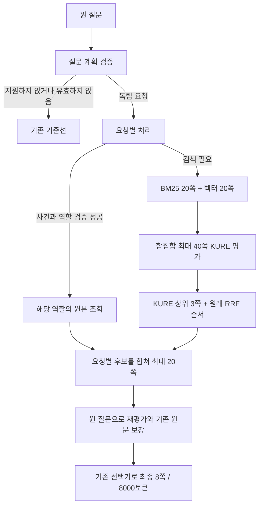

# 요청별 검색에서 근거를 잃는 단계와 후속 검증

2026-11-10. **현재 개인 기준선은 유지했다.** 새 실험은 질문을 요청별로 검색할 때 두 검색기의 후보를 어디서 줄일지, 이미 찾은 페이지를 어떻게 최종 문맥에 남길지를 나눠 비교했다. 답변 생성은 하지 않았다.

**요청별 검색의 개선은 새 질문에서도 재현됐다.** 동료304문항의 최종 전체 근거는126→145건, 일상40문항은13→19건, 새 혼합12문항은2→9건으로 늘었다. 다만 동료 문항에는8개 하락이 남고 실제 계획·검색 p95는 새 표본에서0.434→6.552초로 늘었다. 페이지 교대 배치는 확대 비교에서 성능을 떨어뜨려 채택하지 않았다.

직전 [동일 대상 표현 진단](../advanced-identifier-diagnostic-20261110/report.md)은 충분한 식별 정보가 있는 120문항에서 기존 기준선이 모두 요청 근거를 찾았음을 확인했다. 반면 HG 사건 기록과 IS 업무 규정이 섞인 질문에서는 규정 요청이 전체 질문 검색에서 묻히거나, 벡터가 찾은 페이지가 RRF 상위 20쪽에서 잘리거나, HG 원본을 앞에 붙인 뒤 8쪽 밖으로 밀렸다. 이번 실험은 이 세 단계 중 요청별 후보 확보와 최종 선택을 분리한다.

## 비교 조건

| 조건 | 요청별 검색과 후보 구성 | 최종 선택 |
| --- | --- | --- |
| 기존 기준선 | 원 질문으로 개인 기본 5:5 검색 | 기존 선택 |
| 요청20 | 질문 계획의 요청별 RRF20을 KURE로 평가 | 기존 선택 |
| 요청20+배치 | 요청20과 같은 후보 | 요청별 순위를 교대로 배치 |
| 요청40 | 각 검색기 Top20의 합집합 최대40을 KURE로 평가 | 기존 선택 |
| 요청40+배치 | 요청40과 같은 후보 | 요청별 순위를 교대로 배치 |

검증된 HG 대상·요청 역할은 기존 조회로 원문을 가져온다. 검색이 필요한 요청에는 보관된 Luna 계획의 검색어를 그대로 쓴다. 요청40은 KURE 상위 3쪽 뒤를 원래 RRF20 순서로 채우며, 합집합 전체를 최종 후보로 넣지 않는다. 모든 요청의 결과를 합친 뒤에는 **후보 최대20쪽·최종 최대8쪽·8,000토큰**이다. 따라서 40쪽은 요청별 리랭킹 입력 한도이며 최종 문맥 한도가 아니다.

모델·벡터·5:5 가중치·RRF 상수60은 고정했다. 질문별 정답에 따른 예외는 추가하지 않았다. 지원하지 않는 종속 요청·조건부 집합 또는 원문에 없는 anchor는 전체 질문을 기존 기준선으로 돌린다. 이 문항도 평가 분모에 포함했다.

현재 개인 기본 실행은 전체18,000쪽을 검색하고 결정론적 HG 원문 조회를 적용한다. 과거 일부 보고서의 baseline인 Luna+SQLite 경로와 구분해야 한다.

이 경로에서도 KURE 상위3 후보 선정과 마지막8쪽 선택은 손실 가능 지점이다. 새 후보를 평가했다는 사실만으로 그 후보를 최종 문맥에 넣었다고 볼 수 없다.

## 확대 비교

아래는 **각 질문의 모든 필수 인용 근거가 최종 문맥에 포함된 문항 수**다. 평균 페이지 Recall이나 답변 정확도가 아니다.

| 평가 묶음 | 문항 | 기존 기준선 | 요청20 | 요청20+배치 | 요청40 | 요청40+배치 |
| --- | ---: | ---: | ---: | ---: | ---: | ---: |
| 동료 2문서 | 114 | 51 | 59 | 59 | 59 | 59 |
| 동료 다문서 | 170 | 57 | 67 | 65 | 68 | 66 |
| 동료 전제 오류 | 20 | 18 | 18 | 17 | 18 | 17 |
| **동료 전체** | **304** | **126** | **144** | **141** | **145** | **142** |
| **일상 표현** | **40** | **13** | **18** | **18** | **19** | **19** |
| 기존 별도 검증: 단일 | 12 | 12 | 12 | 12 | 12 | 12 |
| 기존 별도 검증: 복합 | 12 | 7 | 8 | 8 | 9 | 9 |

기존 별도 검증 24문항은 이미 앞선 실험에 사용했으므로 지금은 개발·회귀 검사다. 미사용 검증이라고 부르지 않는다.

| 후보의 전체 필수 근거 확보 | 기존 기준선 | 요청20 | 요청40 |
| --- | ---: | ---: | ---: |
| 동료304: 최초/합친 후보 | 157/304 | 166/304 | 169/304 |
| 동료304: 원문 조회 후 후보 | 157/304 | 167/304 | 170/304 |
| 일상40: 최초/합친 후보 | 14/40 | 20/40 | 21/40 |

요청별 검색은 후보와 최종 근거 양쪽에 개선 신호를 보였다. 합집합40을 리랭킹하는 추가 효과는 요청20 대비 동료 최종 +1건, 일상 +1건으로 작다. **개선의 대부분을 40쪽 확대만의 효과로 해석하면 안 된다.**

요청40은 기준선 대비 동료에서 **27개 개선·8개 하락**, 일상 표현에서 **6개 개선·하락0**이었다. 따라서 평균 상승이 모든 질문의 무손실 개선을 뜻하지 않는다. 요청20은 동료26개 개선·8개 하락, 일상6개 개선·1개 하락이었다.

교대 배치는 좋은 페이지를 보존하는 사례가 있지만, 동료 전체에서 같은 후보의 기존 선택보다 3건 낮았다. 이 배치를 기본값으로 채택할 근거는 부족하다. 동료304와 일상40에서 최고인 요청40 하나를 새 질문 검증 후보로 고정했다.

전체344개 계획 중225개는 현재 독립 요청 지원 범위다. 종속·조건부100개와 원문 anchor 불일치19개는 기준선 복귀다. 모델이 생성한 모든 계획을 실행해 달성한 성능이 아니다. 동료 평가에는 이전 원문 대조에서 전체 인용 매칭을 확인하지 못한14개도 포함하며 분모를 사후 변경하지 않았다.

요청40에서도 전체344개 중 **153개는 조회 후 후보에 필수 근거가 모두 모이지 않았고, 27개는 그 후보에 있던 근거를 최종 문맥에서 잃었다.** 하락8개가 모두 선택 문제라는 사실을 나머지 미해결 문항까지 일반화하지 않는다. 후보 확보와 최종 선택을 계속 별도 지표로 봐야 한다.

독립 재집계에서는 요청40의 하락8개 모두 필요한 근거가 후보와 조회 후 후보에는 있었고 **최종 선택에서 빠졌다.** 후보 확대만 반복해 해결할 하락이 아니다. 이8개는 HG 다섯 원본을 앞에 붙여서 생긴 하락이 아니다. 요청 그룹을 번갈아 합치면서 기존 필수 페이지가 합친 후보7~14위, 조회 후9~14위로 밀렸고 마지막8쪽에서 빠졌다. 요청별 후보를 확보하는 것과 필요한 근거 조합을 최종에 보존하는 것은 별도 문제다. 요청40은 요청20보다 필요한 KURE 질문·페이지 쌍이14,980개에서20,087개로34.1% 늘었다. 검색 횟수는 둘 다650회다. 이 값은 각각 독립 실행한다고 가정한 고유 계산량이며 공유 계산 실행의 실제 호출량과 구분한다. [확대 진단](broad-diagnosis.md)

[확대 집계](broad-01/summary.json) · [문항별 점수](broad-01/scores.jsonl) · [개선·하락](broad-01/changes.jsonl) · [상태·실행량](broad-01/execution-summary.jsonl)

## 혼합 6문항의 원인 분리

| 조건 | 합친 후보 전체 근거 | 조회 후 후보 전체 근거 | 최종 전체 근거 |
| --- | ---: | ---: | ---: |
| 기준선 | 0/6 | 2/6 | 1/6 |
| 요청20 | 3/6 | 4/6 | 2/6 |
| 요청20+배치 | 3/6 | 4/6 | 3/6 |
| 요청40 | 5/6 | 5/6 | 3/6 |
| 요청40+배치 | 5/6 | 5/6 | 4/6 |

이 여섯 질문에서는 원문에서 수동 확인한 규정 절을 사용했다. 위 표는 검색·선택 단계의 원인 분리용이며 자동 계획기의 일반 성능으로 보지 않는다. 확대344와 기존24는 보관된 자동 계획의 검색어를 수정하지 않았다.

H-C07은 합집합40에서 평가하게 하자 규정 근거가 최종 문맥까지 왔다. H-C10은 같은 후보에서도 교대 배치가 규정 페이지를 보존했다. 그러나 H-C12는 요청20+배치에서 충족하던 지정 근거를 요청40+배치에서 잃었다. 개별 실패와 대체 근거 한계는 [혼합 실패 분석](pilot-failures.md)에 남긴다.

## 같은 대상의 표현별 회귀

| 질문 조건 | 문항 | 기준선 최종 | 모든 후속 조건 최종 |
| --- | ---: | ---: | ---: |
| 완전 코드 | 24 | 24 | 24 |
| 소문자·유니코드 하이픈·공백 | 72 | 72 | 72 |
| 유일한 간접 단서 | 24 | 24 | 24 |
| 식별 정보 부족 | 24 | 단일 오확정0 | 단일 오확정0 |

120개 충분 질문에서 기준선 최초 후보119건은 새 후보 구성에서120건으로 늘었지만, 원문 조회 후와 최종은 모두120건이었다. 정보 부족24개는 단일 정답을 가정하지 않는다. 오확정0은 사건 식별 상태의 결과이며 실제 답변의 되묻기 품질은 평가하지 않았다. 이 회귀는 결정론적 rule_plan을 사용했으므로 Luna의 표기 변형 인식률은 아니다.

[144문항 점수](identity-01/scores.jsonl) · [직전 코드 토큰·검색기 분석](../advanced-identifier-diagnostic-20261110/identifier-diagnostics.json)

## 실행 시간 해석

확대 비교는 같은 질문·페이지의 KURE 점수를 조건 사이에서 공유했다. 공통 점수 차이를 후보 효과로 오인하지 않도록 한 진단이며, 실행기 전체 시간이나 조건별 증분 시간을 사용자 요청 지연으로 제시하지 않는다.

독립 측정 실행기는 두 조건의 검색·KURE 결과 캐시를 공유하지 않고 실행 순서를 번갈아 바꾼다. 기존24문항에서 두 조건의 최종 문맥 지문48/48이 확대 실험과 같았다. 워밍업 후 로컬 검색은 기준선 p50 0.324초·p95 0.378초, 요청40 p50 0.514초·p95 0.969초였다. 여기서 계획 호출은 이전 기록의 재사용이다. 과거 계획 시간과 새 검색 시간을 합친 값은 실시간 전체 경로 측정과 구분한다.

새 질문에서는 계획 호출 직후 검색을 실행해 전체 경과 시간 wall_ms를 측정했다. 결과는 다음 절과 같다.

## 새 질문 24문항의 최종 검증

확대 결과를 본 뒤 요청40 하나를 먼저 고정하고, 검색 점수를 보지 않은 독립 작성자가 질문24개를 만들었다. 다른 에이전트가 요청42개·근거 요건70개·인용98개를 검수했다. 원본 PDF47개의 해시와 인용98개의 PDF/복원 페이지 일치를 확인했다. 조사 오류1곳만 실행 전에 수정했으며, 대상·요청·근거를 바꾸지 않았다.

혼합12개, 두 HG 비교6개, IS 규정 단독6개다. HG 대상24개와 IS 문서18개를 사용하며 직전 개발 사례·지정 IS 개발 문서는 제외했다. 그러나 같은18,000쪽 코퍼스를 사용하고 과거 증강에서 이 문서들이 쓰였을 수 있다. **미사용 문서 일반화나 실제 고객 질문 분포 검증은 아니다.** 독립 에이전트 검수이며 현업 담당자의 사람 검수를 대체하지 않는다.

명백한 대체 근거는 검색 전에 등록했다. 전체 근거 충족은 primary 또는 등록 대체 묶음을 인정한다. 페이지 Recall은 primary의 book_id·page를 기준으로 하므로 두 지표를 같은 것으로 읽지 않는다.

| 새 검증 유형 | n | 기준선 후보 / 조회 후 / 최종 | 요청40 후보 / 조회 후 / 최종 |
| --- | ---: | ---: | ---: |
| HG 사건 + IS 규정 | 12 | 4 / 5 / 2 | **12 / 11 / 9** |
| 서로 다른 두 HG 비교 | 6 | 6 / 6 / 6 | 6 / 6 / 6 |
| IS 규정 단독 | 6 | 6 / 6 / 6 | 6 / 6 / 6 |
| **전체** | **24** | **16 / 17 / 14** | **24 / 23 / 21** |

최종 전체 근거는 **14/24(58.3%) → 21/24(87.5%)**, 문항별 **7개 개선·하락0개**였다. 개선된 ID는 FV-001·004·005·007·008·010·011이며 모두 혼합 유형이다. 나머지17개는 최종 완전 충족 여부가 같았다. 작은 표본의7개 순증이지 전체 업무 질의에 대한87.5% 성능 보장은 아니다.

계획 API24회는 모두 완료했다. 실행 검증을 통과한 계획은21개이며 원문 anchor 오류2개와 미지원 종속1개는 기준선으로 복귀했다. 이3개도 분모에 포함했다. API 응답 완료를 계획 해석 정확도100%로 주장하지 않는다. 질문과 고정 지침·스키마만 전송했고 PDF·검색 문맥·정답은 보내지 않았다.

| 워밍업 후 실측, 24회 | 기준선 p50 / p95 | 요청40 p50 / p95 |
| --- | ---: | ---: |
| 로컬 검색·조회 | 0.359 / 0.434초 | 0.936 / 1.054초 |
| Luna 계획 API | 0 / 0초 | 3.620 / 5.515초 |
| **실제 계획부터 검색까지 wall_ms** | **0.360 / 0.434초** | **4.575 / 6.552초** |

동일 장비에서 Snowflake 질의 임베딩은 CPU, KURE는 GPU를 사용했다. 모델 준비·워밍업은 별도 기록했다. 두 조건의 검색·KURE 캐시는 공유하지 않았고 질문별 실행 순서를 번갈아 적용했다. API는 직렬로 질문당1회, 25초 제한·재시도0회, GPT-6 Luna low다. 답변 생성은 포함하지 않는다. 운영 서버 부하나 동시 접속 처리량을 측정한 결과도 아니다.

검색은 기준선24회 대 요청40 43회, KURE는480쌍 대1,348쌍(호출24회 대81회)이었다. API 사용량은 입력17,852·출력6,898토큰, 합계24,750토큰이다. 이는 실제 응답 usage이며 금액 청구 내역은 아니다.

남은 실패는 FV-002·003·006이다. 요청40의 최초 후보에는 세 질문의 모든 근거가 있었지만, 하나는 원문 보강 후 후보에서, 나머지는 최종 문맥에서 잃었다. 개별 위치와 예산 원인은 [새 표본 실패 진단](fresh-diagnosis.md)에 기록한다. 이 결과를 보고 질문·정답·프롬프트·선택기를 수정하거나 같은 표본을 재채점해 개선으로 포장하지 않았다.

[입력 고정과 검수 수치](fresh-inputs.json) · [집계](fresh-01/summary.json) · [문항별 점수](fresh-01/scores.jsonl) · [변화](fresh-01/changes.jsonl) · [호출량](fresh-01/calls-and-changes.json) · [지연](fresh-01/latency.json)

## 판단

이번24사건 표현 실험에서 코드 표기를 조금 바꾸는 것이 주된 누락 원인은 아니었다. 단순 요청의 근거는 잘 찾았지만, 혼합 질문의 서로 다른 요청을 검색하고 그 근거를 끝까지 함께 남기는 과정에서 손실이 컸다.

요청별 검색의 개선은 기존 동료·일상 문항뿐 아니라 새 혼합 질문에서도 재현됐다. 따라서 추가 검토할 가치가 있는 후보로 남긴다. 다만 요청40의 확대 비교에는8개 하락이 남아 있고, 새 표본의 p95는6.55초로 늘었다. 모든 질문에 계획 호출을 붙이는 방식이나 요청별 교대 배치를 기본값으로 채택하지 않는다. **사용자가 지정한 기존 개인 기준선은 유지한다.**

남은 작업은 새 가중치·모델 조합을 늘리는 것이 아니라, 확보된 요청별 근거가 보강·최종 선택에서 사라지는 경계를 다루는 일이다. 이24문항을 이후 선택기 개발에 사용한다면 더 이상 미사용 검증이라고 부르면 안 된다. 별도 검증 없이 현재 후보를 운영 품질이 입증된 개선으로 결론내리지 않는다.

## 재현과 보관

[사전 조건과 실패 실행 이력](protocol.md), [실행기](../../advanced_evidence_benchmark.py), [독립 시간 측정기](../../advanced_evidence_validation.py), [후보·배치 함수](../../advanced_evidence_policy.py)를 함께 읽는다.

실제 검색 결과와 원문 문맥은 로컬 artifacts/u_10o0o/advanced-evidence-preservation-20261110/에 있다. 이 기록 폴더에는 질문 원문·PDF 인용·문맥을 복사하지 않고 수치·지문·문항ID·실행 조건을 남겼다. 각 실행은 결과를 저장한 뒤 정답 파일을 읽었고 입력·코드 지문이 실행 전후 같은지 확인했다.

pilot-01은 검색 저장 후 채점 어댑터 오류로 끝난 실패 실행이며 보존했다. pilot-02의 summary 페이지 Recall은 합산값이다. 문항별 점수는 정상이며 후속 실행부터 Recall 평균으로 저장한다. 위 표는 필수 근거 충족 건수이므로 그 출력 집계 오류의 영향을 받지 않는다.

## 검증 결과

저장소 Ruff, 새 실험 파일의 별도 Ruff·포맷 확인과 두 CLI 도움말이 통과했다. 전체 테스트271개와9개 subtest가 통과했다. 신규 검색·문맥 함수는 독립 리뷰했고, 확대·새 표본의 집계와 지문도 별도로 대조했다. 완료한 조건별 평가2,686개에서 통합 후보20쪽·확장 후보20쪽·최종8쪽 한도를 지켰으며 관측 최종 토큰 최댓값은6,881이었다. 새 입력과 실행 코드229개 지문은 새 검증 실행 전후 동일했다. [검증 기록](checks.json)

운영 API·개인 기본 실행·패키징은 이번 작업에서 변경하지 않았다. 기존 작업 트리의 다른 변경도 보존했다. 전체271개 테스트는 최종 코드 리뷰 후 실행했고, 이후 변경은 보고서·결과 기록뿐이다.
