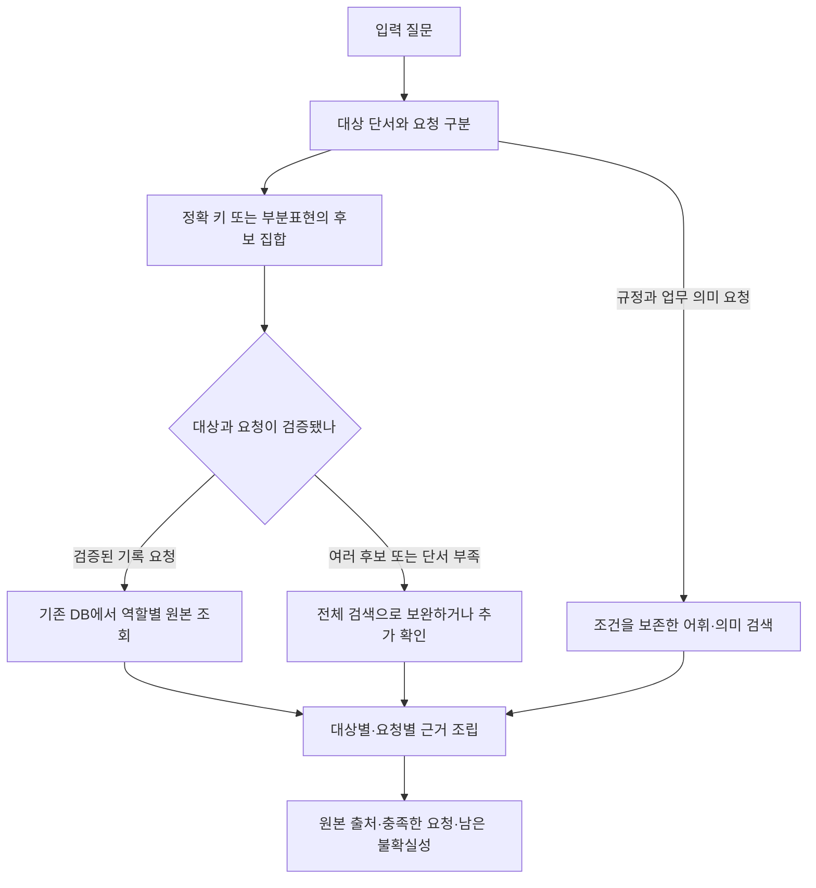

# Advanced에 맞는 검색 방식과 우선순위

2026-11-10. 데이터와 기존 실행을 바탕으로 한 설계 검토다. 아래 구조는 새로 채택된 기준선이 아니다. 세부 기술의 공식 출처는 [어휘·의미 검색 조사](lexical-and-semantic-references.md)와 [관계·구조화 검색 조사](graph-and-structured-references.md)에 있다.

## 1. 비교할 축부터 분리한다

BM25, GraphRAG, SQLite, 하이브리드는 같은 자리를 대체하는 네 제품이 아니다.

| 축 | 선택 사항 | 이 데이터에서 답할 질문 |
| --- | --- | --- |
| 데이터 표현 | 페이지, 사건·역할 레코드, 규정·조건·표 단위 | 무엇을 검색 결과 한 개로 볼 것인가? |
| 대상 결정 | 정확 키, 검증된 동등 표기, 부분표현의 후보 집합, 복합 조건 | 어떤 사건·장비·계약을 말하는가? |
| 관련성 점수 | BM25/필드별 점수, dense, learned sparse, late interaction | 질문의 업무 표현과 관련된 근거가 무엇인가? |
| 관계 회수 | SQL join, 인접 리스트, 그래프 순회 | 확인된 대상과 어떤 원본 기록이 연결되는가? |
| 실행 계획 | 직접 조회, 검색, 여러 요청의 결합, 추가 확인 | 이번 질문에서 어떤 작업이 필요한가? |
| 최종 선택 | 중복 제거, 요청별 근거 보존, 제한된 재정렬 | 모든 요청을 설명할 근거가 최종 문맥에 남는가? |
| 저장·운영 | SQLite, PostgreSQL, Elasticsearch/OpenSearch, 그래프 DB | 필요한 쿼리·관리·규모를 어떤 시스템으로 실행할 것인가? |

현재 자료에서 BM25가 좋은 점수를 내는 것은 이상 현상이 아니다. 완전 코드의 어휘 일치는 구별에 유용하다. 다만 **그 토큰이 고유 사건을 나타내는지, 유일성이 확인된 계약 코드인지, 여러 사건이 공유하는 장비 종류인지**는 BM25 점수만으로 결정할 수 없다. '정확히 같은 문자열'과 '정확히 같은 업무 대상'을 별도 조건으로 둔다.

## 2. 주요 대안 평가

사용자가 요청한 폭넓은 검토를 위해 대안을 범주별로 나열했다. 아래는 일괄 실행 계획이 아니다. 우선순위는 데이터에 대한 설계 판단이며 실측 성능 순위가 아니다. 기존에 시행한 접근은 [실험 감사](prior-evidence.md)를 함께 본다. 정확 HG 조회·역할 확장·질의 계획·최종 역할 선택은 이미 존재하므로 해당 행의 의미는 기존 기능의 범위 재검토다.

| 방법 | 직접 해결할 수 있는 문제 | 해결하지 못하는 문제·비용 | 검토 판단 |
| --- | --- | --- | --- |
| 타입별 정확 키 + SQL/해시 조회 | 확인된 예약·장비·증빙에서 사건·역할·출처 회수 | 공유 유형의 모호함, 자유 표현의 업무 의미. 현재 CT 완전 코드는 사건별로 유일하지만 일반 데이터 확장은 재검증 필요 | 기존 HG 코드 조회 구현을 재사용하고 지원하지 않는 입력만 점검 |
| 부분표현 후보 집합 + 복합 필터 | 장비종류·화주·화물·기간의 교집합으로 대상 축소 | 단서 자체가 부족하거나 같은 조건의 사건이 여럿이면 유일 확정 불가 | 기존 프로필·규격 조회를 재사용하고 미지원 표현의 인식·오확정 검증 |
| 정확 필드와 본문 필드를 분리한 lexical search | ID와 제목·역할·조건이 한 본문에서 경쟁하는 문제 | 엔터티와 역할을 잘못 추출한 경우 | 현행 제목 보너스와 무엇이 다른지 먼저 명시 |
| BM25F·필드별 BM25·다중 필드 쿼리 | 제목·역할·표 열·본문을 다르게 다룸 | 가중치 탐색만으로 잘못된 관계를 해결할 수 없음 | 규정 및 역할 검색에 후보 |
| TF-IDF·언어모델 점수·DFR 등 다른 lexical 점수 | 같은 용어의 희소성·길이·빈도를 다른 방식으로 평가 | 서로 다른 표현·타입·관계를 자동으로 복원하지 않음 | 분석 단위·필드 문제를 고친 후 필요한 경우에만 비교 |
| Boolean/phrase/proximity/범위 조건 | 여러 단서의 AND, 문구·열거 관계, 날짜 조건 | 한국어 일상 표현·누락 단서는 약함 | 확실한 제약은 점수와 구별해 실행 |
| Bigram·Nori·Kiwi·ID 원형 병행 | 한국어 조사·표기·정확 코드 검색 | 부분코드의 의미, 다른 사건의 연결 | 기존 비교를 보존하며 코드 표기 변형 진단부터 |
| 사전·동의어·약어 확장 | 검증된 현장 표현→업무 개념 대응 | 상위 유형을 특정 장비와 동의어로 만들면 오확정 | 동등 별칭과 분류 관계를 구별할 때 유효 |
| 문자 n-gram·trigram·fuzzy | 오타·일부 표기의 후보 생성 | 비슷한 다른 코드가 존재하면 위험, 한국어 짧은 질의 제약 | 후보 생성 보조. 자동 확정 근거로 사용하지 않음 |
| 필드/업무 문맥을 보존한 dense | 단어가 다른 업무 설명·규정 검색 | 불투명 코드의 정확 동일성, 날짜·상태 제약 보장 | 기존 Snowflake-ko를 유지한 입력 진단이 먼저 |
| learned sparse, SPLADE 계열·다국어 sparse | 원문에 없는 의미 관련 용어까지 어휘 공간에서 확장 | 모델·언어 편향, 인덱스 확장, 숫자 동일성 보장 없음 | 규정 표현 대응의 실패가 남을 때 비교 |
| ColBERT 계열 late interaction | 질의 각 토큰과 문서 토큰 간 세부 의미 매칭 | 인덱스/연산 증가, 관계·정확 코드 검증은 별도 | 단일 벡터 표현이 한계일 때 후순위 비교 |
| 기존 제한된 관계 순회·SQL join | 확인된 코드→사건→역할 또는 명시 계약 연결 회수 | 출발 대상이 틀리면 잘못된 관련 자료를 확대 | 기존 HG 연결을 재사용. 새 관계가 필요한 질문부터 |
| GraphRAG local/hybrid traversal | 비정형 엔터티 관계와 텍스트를 함께 탐색 | 엔터티 추출/병합·허브 확장·순위 손실, 추가 관리 | 원문으로 검증 가능한 관계에 한정해 후보 |
| Microsoft GraphRAG global·community summary | 자료 전체의 큰 주제·패턴·경향 질문 | 금액·상태·특정 사건 출처의 정확 조회와 목표가 다름 | 현재 주 과제에서는 우선순위 낮음 |
| HippoRAG/PPR·PathRAG류 | 여러 관계를 경유해 다른 방식으로 드러나는 근거 회수 | 공유 업체·장비 유형에 순위가 몰리는 위험, 추출 그래프 품질 의존 | 검증된 다중 hop 문제와 정확 seed가 있을 때 |
| 기존 LLM 질의 계획과 추가 확장 대안 | 자연어 요청 분리, 질의 어휘 차이 보완 | 새로운 조건 추가·번호 변형·지연, 환각한 단서 | 이미 요청별 검색 실험 있음. 진단된 실패에 제한 |
| pseudo-relevance feedback/RM3 | 상위 결과의 어휘로 재검색 | 처음 찾은 다른 사건을 강화하는 query drift | 코드·사건 과제에서는 낮은 우선순위 |
| LTR·리랭커 튜닝 | 같은 후보에서 역할·근거의 우선순위 개선 | 후보에 없는 근거를 만들지 못함, 평가 누수 | 후보 충분성을 먼저 확인하고 학습 분리 |
| 기존 요청별 선택의 경계 검토 | 여러 대상·역할에서 한쪽만 문맥을 차지하는 문제 | 요청 인식·근거 대응 자체가 틀리면 무효 | 기존 역할·두 사건 선택과 입력 차이를 검증 |
| SQL 집합·집계·계산 | 기간 조건, 수납 합계, 미결 목록 등 완전한 레코드 연산 | 일부 쪽 Top K만으로 전체 집계 보장 불가 | 그런 업무를 지원할 때 별도 계약 필요 |

ANN은 벡터 후보 검색의 속도·메모리를 조정하는 방법이다. 현재 근거 누락이 exact dense에서도 생긴다면 ANN 도입으로 의미 정확도가 좋아진다고 기대할 근거는 없다. 문서 전체를 긴 프롬프트에 넣는 방식도 비용·출처·정확 조건 검증이 달라지며, 현재 검색까지만 비교하는 과제의 직접 대안으로 삼지 않는다.

리랭커나 임베딩을 학습할 때는 같은 양식의 다른 사건, 같은 사건의 다른 역할, 같은 업무의 다른 효력·예외를 구분하는 hard negative가 유용한 검증 대상이다. 다만 이것은 제안이며 ADEN에서 효과를 측정하지 않았다. 정답 쪽을 나눠 배치하는 것으로 학습/검증을 분리했다고 보지 않고 사건·템플릿·질문 생성 계열의 중복도 확인한다. 학습된 점수 역시 코드 동일성과 상태 검증을 대신하지 않는다.

TF-IDF 계열과 확률 언어모델 등 여러 lexical scorer 중 무엇을 택하더라도 검색 가능한 용어·필드·관계가 먼저 정해져야 한다. [Elasticsearch similarity 공식 문서](https://www.elastic.co/docs/reference/elasticsearch/index-settings/similarity)는 BM25 외 DFR·DFI·IB·LM Dirichlet·LM Jelinek Mercer 등의 점수 방식을 제공한다. 이 기능 목록은 점수 함수 교체만으로 ADEN 근거를 회복한다는 증거는 아니다.

## 3. 권하는 데이터 모델

현재 실험용 SQLite와 원본 연결은 이미 정확 코드·장비 유형·사건·역할을 구분한다. 다음은 그 기존 모델을 읽고 조회 입구와 질문 표현의 지원 범위를 확인하기 위한 목록이다. 새 DB나 중복 관계 로더를 제안하지 않는다. 기본 advanced_search와 Luna·SQLite 실험 경로는 별도이므로 적용 상태도 함께 확인한다.

- **대상** — 사건, 개별 장비, 계약, 증빙, 업무 기록.
- **속성·분류·출처 묶음** — 장비 종류, 화물 종류, 화주, 기록 날짜의 종류, 상태, HS 인계철 묶음. `HS-057`도 150사건이 공유하므로 코드 모양만 보고 고유키라고 판단하지 않는다. 같은 속성을 가진 두 사건은 여전히 별개의 사건이다.
- **검증된 동등 표기** — 동일 대상의 공식 별칭·허용 표기. 출처·적용 범위·유효 기간을 갖는다.
- **관계** — 사건이 어떤 장비·계약·증빙을 참조하는지, 어느 기록 역할과 원본 쪽을 갖는지. '같은 페이지에 등장'과 '해당 계약이 적용됨'은 별도다.
- **규정** — 규칙 본문, 적용 대상·기간, 예외·우선순위, 원본 위치. 명시적인 참조나 검증된 적용 조건이 있을 때만 사건과 확정 연결한다.
- **출처** — PDF 지문, `(book_id, page)`, 행·열 또는 원문 범위. 검색용 표현을 바꿔도 이 연결을 유지한다.

개별 장비의 전체 코드가 원문에 있으며 질문에는 장비 종류만 나온 경우, 종류→여러 개별 장비→여러 사건의 관계를 유지한다. 이것을 '종류의 모든 동의어는 한 장비 코드'로 등록하지 않는다. 짧은 숫자·코드 일부가 어느 필드인지도 질문과 사전 정의로 확인해야 한다.

### 모델 없이 결합할 수 있는 알고리즘

- **원문 코드 사전 + trie/Aho–Corasick** — 검증된 전체 코드·별칭을 사전으로 만들고 질문에서 여러 항목을 한 번에 찾는다. 정규식이 코드 모양을 찾는 것과 달리 실제 원장에 존재하는 값을 찾을 수 있다. 코드 사전 갱신, 긴 코드와 그 안의 부분 토큰 중복, 한국어 조사 경계는 별도 처리해야 한다. 아직 등록되지 않은 코드를 자동으로 올바른 코드라고 추정하는 방법은 아니다. [pyahocorasick 공식 문서](https://pyahocorasick.readthedocs.io/en/latest/)
- **후보 집합의 교집합·차집합** — 원문에서 검증된 화주·장비 유형·날짜 종류·제외 조건을 각각 사건 집합으로 만들고 요청의 논리에 따라 결합한다. 현재 HG 프로필 조회와 코드 관계의 기능을 재사용한다. 빈 교집합이 나오면 조건을 몰래 삭제하지 않고 충돌로 남긴다.
- **타입과 방향을 제한한 관계 순회** — 정확 코드에서 사건을 찾고 필요한 역할·출처까지 따라간다. 공유 유형 노드를 통해 전체 사건으로 퍼지는 순회는 목적이 다르다. 현재 SQL과 인접 맵으로 지원되는 짧은 경로는 그대로 활용한다.
- **요청별 제약을 둔 선택** — 최종 문맥의 한 자리가 어떤 대상·요청을 새로 충족하는지 계산한다. 탐욕적 coverage 선택이나 제한된 조합 탐색을 고려할 수 있지만, 근거의 요청 대응이 먼저 검증돼야 한다. 단순 다양성(MMR)과 요청의 완전한 근거 충족은 같은 목표가 아니다. 이 항목은 기존 역할 선택과의 차이를 먼저 정의할 제안이며 새 알고리즘의 효과를 측정하지 않았다.

## 4. 권하는 실행 흐름

아래는 논리 흐름이다. 현재 모든 경로가 이대로 통합돼 있다는 뜻은 아니다.

한 질문에 DB와 규정 검색이 둘 다 필요할 수 있다. 라우팅은 질문 전체를 HG/IS 중 하나로만 고르는 분류가 되면 안 된다. 또한 IS에도 구조화 기록·키가 있으므로 'HG=DB, IS=벡터'를 문서군의 고정 법칙으로 두지 않는다.

대상별 필요한 기록이 확인되면 원본 관계로 가져오고, 규정은 검색으로 확보한다. 확정된 원본을 일반 유사도 경쟁에 다시 넣어 관계없는 페이지 때문에 모두 잃게 하지 않는다. 최종 선택은 `(대상, 요청, 근거 종류)`의 충족을 먼저 확인하고 그 안에서 중복·순위·예산을 조정한다. 이 제안의 효과는 [고정 후보 진단](methodology-and-next-tests.md)에서 확인해야 한다.

## 5. GraphRAG를 선택할 기준

GraphRAG라는 이름을 쓰는지보다 **무슨 관계가 없어서 못 찾는가**를 먼저 적는다.

- 사건 키→다섯 역할 원본은 지금도 관계 검색이며 SQL로 충분히 표현된다.
- 향후 원문에서 계약→조항→효력→예외처럼 새 경로와 그 경로가 필요한 질문이 확인되면 관계의 추출·검증부터 시작한다. 이 예시는 현재 코퍼스에서 해당 모든 연결을 검증했다는 뜻이 아니다.
- 데이터에서 명시적으로 확인되는 관계는 결정론적으로 적재한다. LLM은 관계 후보 제안에 쓸 수 있지만, 미검증 관계를 업무 사실로 취급하지 않는다.
- 같은 화주나 장비 종류를 공유하는 모든 사건을 연결하면 연결 수는 많아져도 원하는 사건을 구별하기 어려워진다. 허용 관계 유형·방향·깊이·후보 상한이 필요하다.
- 그래프 DB 도입은 깊이와 관계 종류가 늘어나 SQL 유지·성능에 문제가 확인될 때 판단한다. 18,000쪽이라는 문서 수만으로 필요성을 결정하지 않는다.

## 6. 기존 구현에서 확인한 작은 표기 문제의 위치

`tokenize_bigram_id()`를 직접 호출해 확인했다. 대문자 `HL-20GP-0066`에는 전체 코드 토큰이 추가되지만 소문자·유니코드 대시·공백 변형은 부분 토큰만 생성한다. `20GP`와 `20 GP`의 토큰 수도 다르다. [실측 토큰과 코드 지문](identifier-tokenization.json) · [현행 토크나이저](../../bm25.py)

이는 입력 표기 계약을 점검할 이유다. 검색 전체의 정확도 하락 원인을 이 한 차이로 설명하지 않는다. 다른 DB 경로는 자체 정규화를 하며, 이번 확인은 해당 토크나이저의 출력만 측정했다. 어떤 표기를 같은 것으로 허용할지는 데이터의 실제 코드 규칙과 충돌 검증으로 정한다.

## 7. 이번 조사에서의 판단

가장 먼저 투자할 영역은 **기존 관계 조회의 범위를 명확히 하고, 코드·공유 속성·업무 규정을 서로 다른 검색 대상으로 표현하는 일**이다. 그다음 남은 규정 검색 실패의 위치를 진단한다. 현재 증거는 모든 쪽을 DB 전용으로 빼거나, 모든 질문에 그래프/LLM 호출을 붙이거나, 새 벡터 모델 하나로 통일할 근거가 되지 않는다.

기존의 5:5·HG 조회와 원본 출처를 살려서 필요한 연결만 검증한다. 이후 모델·엔진 선택은 동일한 대상·근거 계약 안에서 비교한다.

## 추가 참고자료

- [Faiss index 선택 지침](https://github.com/facebookresearch/faiss/wiki/Guidelines-to-choose-an-index)은 exact flat 검색과 HNSW 등의 속도·정확도·메모리 절충을 구분한다. ANN과 업무 의미의 정확도를 별개로 본 근거다.
- [HyDE 원 논문](https://aclanthology.org/2023.acl-long.99/)은 가상 문서를 생성해 임베딩하는 방법을 제안하며 그 문서가 환각을 포함할 수 있음을 밝힌다. 원문에서 확인해야 할 업무 코드를 생성 문서의 번호로 바꾸어서는 안 된다는 것은 이 데이터에 대한 설계 판단이다.
- [Vespa ranking 문서](https://docs.vespa.ai/en/basics/ranking.html)는 필드·질의·관련성 특징과 학습 모델을 결합하는 순위 체계를 설명한다. LTR은 별도 학습 라벨과 검증 분리가 필요한 후속 선택지다.
- [Pyserini 공식 검색 코드](https://github.com/castorini/pyserini/blob/master/pyserini/search/lucene/__main__.py)는 BM25·RM3·Rocchio 등 lexical/feedback 설정을 제공한다. 상위 후보가 틀렸을 때 해당 사건의 어휘가 강화될 수 있다는 점은 ADEN에 적용할 때 점검할 가설이다.

확인일 2026-11-10. 설치·실행은 하지 않았다.
