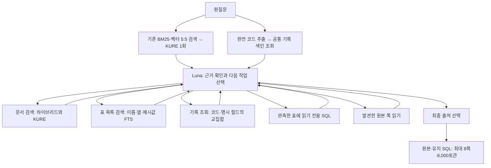

# 통합 TableRAG 실험 실행

최종 채택과 기능별 구분은 [종료 결정](../records/advanced-table-rag-closeout-20261112/decision.md)을 따른다. 선택한 진입점은 `table_rag_unified query --db-first`이며 `--verify-evidence`는 붙이지 않는다. 아래 비교용 경로의 기본값은 과거 재현을 위해 유지한다.

HG 전용 검색 후 보강 대신 공통 코드·기록·원본 색인을 사용하는 개인 실험이다. HG·HA의 사건 기록과 IS의 식별 가능한 표 행을 같은 도구로 조회한다. 운영 API, 기존 `table_rag`, `advanced_search`의 기본 실행은 바꾸지 않는다.

## 처리 흐름



기본 모드에서는 기존 검색을 한 번 실행한다. 문서 검색 도구를 다시 호출하면 해당 질의로 최대20개 후보를 한 번 리랭킹한다. 기록 조회·표 목록 검색·SQL·원본 읽기는 임베딩과 리랭킹을 호출하지 않는다. 서로 다른 질의의 결과를 합친 뒤 다시 리랭킹하지 않는다. Luna가 실제 발견한 필수 출처를 선택하면 최종20개 후보에 먼저 보존한다.

Luna는 GPT-6 Luna `medium`, 요청당 최대5회 도구 작업 후 finish다. 답변 생성은 없다. 실제 질문·발견 근거·표 스키마·필요한 SQL 결과를 계획자에게 제공한다. 전체 원본이나 평가 정답을 보내지 않는다. 도구 출력의 원문은 자료이며 실행 지시로 취급하지 않는다.

## 공통 SQLite 색인

| 테이블 | 내용 |
|---|---|
| entities | HG·HA 사건, IS 원본 표의 개별 기록 |
| keys | 완전 코드 → 대상, 코드 종류, 원본 출처, 명시 참조 여부 |
| attributes | 원문에 확인된 화주·화물·규격·계약·날짜 종류 |
| sources | 대상 → 원본 쪽·역할·순서 |
| tables / table_terms | 기존 검증 표의 스키마와 FTS 검색용 메타데이터 |

값 계산용 원본 표와 행·열 출처는 기존 TableStore를 그대로 사용한다. 공통 색인은 표의 수치 데이터베이스를 다시 만드는 것이 아니라, 기록·코드·출처와 전체 표 발견을 연결한다.

HG는 기존 검증된 명시 코드 관계, HA는 원문에 명시된 예약·장비·원계약 관계, IS는 검증된 물리 표의 기록번호와 대상·근거 필드의 완전 코드를 사용한다. 모든 IS 페이지를 사건 테이블로 변환하거나 모든 자연어 관계를 자동 추론하는 구현은 아니다. 식별 가능한 행이 없는 IS 설명·규정은 원문 검색으로 찾는다.

- 한 대상에 여러 코드·필드를 넣으면 AND로 조회한다. 여러 대상은 각각 유지한다.
- 완전 코드의 대소문자·대시·주변 공백을 정규화한다. 일부 번호나 공유 규격만으로 코드를 완성하지 않는다.
- 20GP 같은 규격은 조회 조건이며 고유 사건 ID가 아니다. 여러 후보는 `ambiguous`, 서로 존재하는 조건의 교집합이 없으면 `conflict`다.
- 최대8개의 대상 후보 메타데이터를 반환한다. 더 많으면 `truncated`를 표시하고 원본을 임의의 사건 하나로 좁히지 않는다.
- 날짜 종류를 구분한다. 등록일을 실제 반출일로 바꾸지 않으며 미접수·공란은 확정 날짜로 넣지 않는다.
- 모호한 자연어 제외 범위와 날짜 의미는 완전히 해결한 것이 아니다. 명확한 코드 제외는 검증기로 거절하고, 나머지는 계획자·보류 상태에 맡긴다.
- 별도 SQLite 서버나 그래프 서버는 사용하지 않는다. 파일은 해시 검증 후 읽기 전용으로 연다.

## 명령

저장소 루트의 기존 가상환경을 사용한다.

```bash
.venv/bin/python -m experimental.u_10o0o.table_rag_unified --help
.venv/bin/python -m experimental.u_10o0o.table_rag_unified build --output artifacts/u_10o0o/advanced-snapshots/새-폴더
.venv/bin/python -m experimental.u_10o0o.table_rag_unified lookup HG2029-00660
.venv/bin/python -m experimental.u_10o0o.table_rag_unified query "조회할 질문" --output artifacts/u_10o0o/새-결과.json
```

`query`만 외부 API를 호출한다. 기존 결과·색인 디렉터리는 덮어쓰지 않는다. 벡터와 검증 표가 있는 기존 V5 실행 환경이 필요하다. 별도 실행 프로세스 안에서만 검색 어댑터를 연결하며, A/B 동시 실행은 ContextVar로 HG 전용 보강 여부를 분리한다.

최종 [비교 보고서](../records/advanced-table-rag-unified-20261112/report.md)에서 지정 근거·대체 근거 검수·지연을 함께 확인할 수 있다. 이번 고정 비교와 과정은 [실험 기록](../records/advanced-table-rag-unified-20261112/work-log.md), 실행 코드는 [run_benchmark.py](../records/advanced-table-rag-unified-20261112/run_benchmark.py)에 있다.

## 설계 근거

[TableRAG 2025](https://arxiv.org/html/2506.10380v1#S3)의 문서 검색·스키마 발견·조건부 SQL 조합을 참고했다. 코드 관계 조회는 이 데이터의 검증 가능한 명시 관계를 연결한 추가 구현이며, 논문의 동일 구현이나 성능 재현으로 주장하지 않는다. [TableRAG 2024](https://papers.nips.cc/paper/2024/file/88dd7aa6979e352fda7c4952ca8eac59-Paper-Conference.pdf)의 스키마·셀 검색도 참고했다. 관계 조회와 텍스트 검색을 함께 쓰지만 범용 GraphRAG를 구현한 것은 아니다.

## DB 우선 비교 모드

`query --db-first`는 완전 코드가 모두 유일한 대상과 원본에 연결될 때 초기 하이브리드 검색을 생략한다. 공통 DB의 원본·표 스키마를 Luna에게 먼저 제공하고, 부족한 규정이나 기록은 기존 검색 도구로 보충한다. 코드가 없거나 명시 제외·미확인·복수 대상 후보가 있으면 기존 검색으로 시작한다. DB 오류는 검색으로 숨기지 않는다.

```bash
.venv/bin/python -m experimental.u_10o0o.table_rag_unified query "조회할 질문" --db-first --output artifacts/u_10o0o/새-db-first-결과.json
```

프롬프트·도구·선택기·최종 예산은 기본 모드와 같다. DB 조회만으로 종료해도 Luna 호출은 있으며, 모델과 색인은 실행 전에 준비한다. 코드 없는 간접 식별 질문의 검색 생략과 콜드 스타트 최적화는 포함하지 않는다. [DB 우선 비교 과정](../records/advanced-table-rag-db-first-20261112/work-log.md)에 실행 조건과 검증을 남긴다.

## 요청별 근거 확인 비교 모드

`query --db-first --verify-evidence`는 기존 DB 우선 실행에 요구별 근거 확인을 추가한다. Luna의 종료 결과에는 질문의 실제 구절, 확인할 항목, 지원 상태, 읽은 원문 인용과 출처가 들어간다. 읽지 않은 후보에는 짧은 탐색용 미리보기를 제공하고, 필요한 본문은 기존 `read_sources`로 확인한다. 미리보기는 인용 근거로 인정하지 않는다.

Python은 질문 구절과 인용의 존재, 출처 선택, 실제 최종 문맥에 인용이 남았는지를 검사한다. 잘못된 종료 요청은 남은 작업 횟수 내에서 수정하도록 반환하고, 최종 문맥에서 근거가 빠지면 충분 상태로 종료하지 않는다. 후보20·최종8쪽·8,000토큰과 모델·검색기는 그대로다. 옵션이 없으면 기존 동작을 유지한다.

이 검사는 질문의 요구를 모델이 빠짐없이 나눴는지 또는 인용이 의미상 충분한지까지 보장하지 않는다. [요청별 근거 확인 실험](../records/advanced-table-rag-request-evidence-20261112/work-log.md)에서는 공식58의 양쪽 반환 문맥116개를 사후 검수한다. 지정 페이지 전체 충족과 실제 근거 전체 충족은 별도 지표다.
